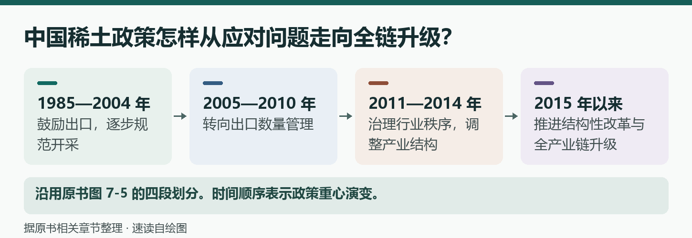
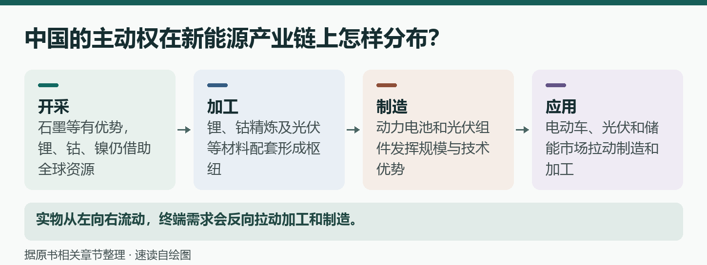

# 第七章 中国在战略性矿产全球格局中的大国地位

[原书第七章](<../第七章-中国在战略性矿产全球格局中的大国地位/第七章-中国在战略性矿产全球格局中的大国地位.md>)

**作者的推理路线**　先从资源、产能和市场确定中国的大国地位，再用稀土和镓解释优势从何而来，把这一判断放到新能源全链条验证，最后检查哪些短板会限制主动权。

## 一、中国的供给和需求为何要放在一起看？

中国在钨、稀土、锑、石墨等矿种有不同程度的资源和产能优势，也拥有庞大的制造与消费市场。作者把两面放在一起，是因为**大市场既提供议价和布局的条件，也把原料需求推高**。新能源汽车、电池和光伏企业能够用规模扩大采购、推动海外资源投资，但锂、钴、镍等矿源仍会受到进口依赖的约束。即便在优势矿种上，买方市场结构、国内行业组织和交易机制也会影响定价。

## 二、用稀土拆开看｜有储量怎样才能变成有话语权？

作者先打破「稀土一概罕见」的直觉。元素有多少、哪些地方形成经济可采的矿床、谁能把混杂的元素有效分离、谁能制成高性能磁材，是几道不同的门槛。

原书图 7-4 显示，中国在全球稀土**产量**中的占比，从高峰时超过 90% 降到 **2024 年的 69%**。与此同时，分离冶炼、产业配套和部分功能材料依然支撑着中国的地位。作者用早期「有产量、无定价权」的处境说明，规模本身也要经过治理、成本控制和技术升级，才会转化为更牢靠的控制力。

图中是原书归纳的四段政策重心。镓通常伴随铝产业生产，因此镓的需求增加后，供应也未必能立即跟上。两种矿产共同说明，话语权要追到生产工艺和产业组织上。

## 三、把判断放进新能源链｜什么叫「中间强、两端不均」？

**开采端**有石墨等局部优势，锂、钴、镍还要借助全球资源。**材料加工端**在锂、钴精炼以及多晶硅加工上有很强的配套能力。**制造端**的电池和组件受益于规模和技术。**应用端**的车、光伏、储能需求又拉动制造，制造规模扩大后压低成本，进一步推动应用。原书借这组关系把市场规模与中下游优势接了起来。

看原书图 7-6 时，跟着同一材料看采矿、加工与电池制造的地理份额，留意哪一段的集中程度变化最大。

## 四、最后检验短板｜优势为什么还需要转化？

新能源首先受上游矿源集中、进口政策和运输风险约束。半导体和高端制造还面临高纯材料、高端薄膜和磁体的技术门槛。镓、铟等在产品中分布分散，回收需要技术和规模支撑。作者因此把**矿源多元化、突破高端材料技术、扩大二次资源利用**放在一起推进。

**读完能复述什么？** 稀土说明供应链优势如何长出来，新能源说明优势在哪一环，锂、钴、镍与高端材料说明风险又会从哪里传进来。
