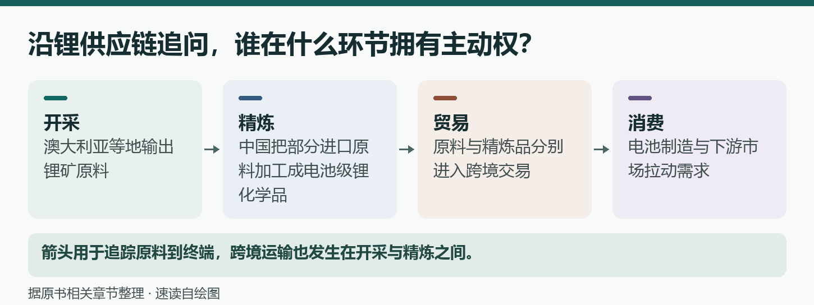
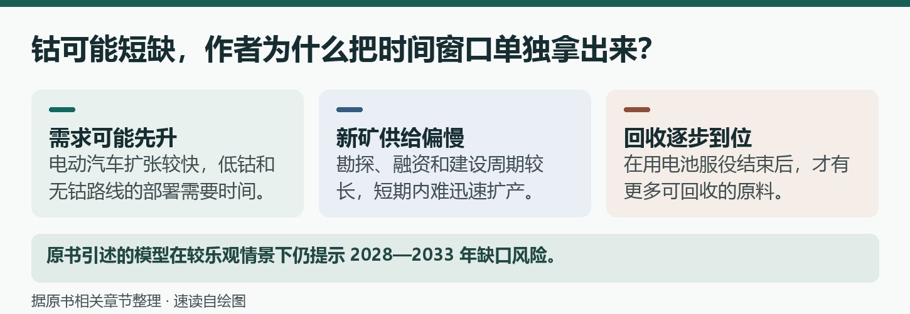

# 第三章 变化中的全球供求格局

[原书第三章](<../第三章-变化中的全球供求格局/第三章-变化中的全球供求格局.md>)

**作者的推理路线**　先问供应权集中在哪些国家和环节，再沿贸易通道看风险如何传导，接着看能源转型怎样改变需求，最后用钴说明供给为何赶不上某段时间的需求。

## 一、生产与供给｜有矿的国家为什么未必掌握整条链？

**第一层是地质。** 矿床形成有特定条件，例如刚果（金）的铜钴成矿带为钴开采提供了集中矿源。**第二层是经济与技术。** 开矿需要资本和漫长的建设期，冶炼提纯又有技术、成本与环保门槛。**第三层是政策和控制权。** 出口政策影响流向，跨国企业通过并购、参股与投资扩大对产能的控制。这三层叠加，才能解释为什么储量、开采和精炼往往集中在不同地方。

把这个判断放进具体矿种。铜的开采分布在智利、秘鲁、刚果（金）等地，中国在精炼端有优势。澳大利亚和智利供应大量锂原料。据原书引述，**2024 年中国拥有全球锂化学品约 70% 的精炼产能**。印尼是镍的重要矿源，其当地精炼能力又包含中资企业的投资。石墨和稀土进一步表明，加工能力本身可以成为一个关键节点。

图 3-2 先看同一矿种两年的精炼份额，有余力再对照原书图 3-1 的开采份额。国家在两张图里的位置差异，就是作者紧接着转向贸易的理由。

## 二、贸易与流通｜一批矿从哪里运，为什么也能决定供给？

刚果（金）和赞比亚等地的矿产必须借铁路和港口出海。洛比托走廊的建设与运营会改变运输成本、交付可靠性和买方选择。即使矿山按计划生产，航运与转运节点也可能成为瓶颈。

图用锂简化这一过程。澳大利亚等地输出原料，中国在中游精炼，再进入各地的电池制造和应用。实际运输发生在多个环节，读贸易数据时要先分清交易的是矿石、精炼品还是终端产品。钴的例子进一步显示，掌握矿源、加工和客户的主体可以各不相同。

## 三、消费与短缺窗口｜为什么需求变了，供给来不及变？

能源转型把矿产需求拉向动力电池、风电和电网。欧盟强调把供应链和采购来源稳定下来，资源富国依托矿源保持主动，中国则把加工规模与市场需求结合。作者借「囤货」概括这些不同的保供方式。

需求还有结构变化。原书引用的**既有政策情景**下，清洁能源用途在全球锂消费中的占比，预计由 2021 年约 40% 变为 2050 年约 87%。这使技术更新、产能建设和矿源保障必须一起看。

原书引述的模型研究显示，即使在较乐观的技术和回收情景下，**2028—2033 年仍可能出现钴供给缺口**。新矿建设要时间，进入应用的电池也要服役一段时间才会成为回收原料。于是，作者提出初级供给、替代、回收和国际合作并举。

**读完能复述什么？** 储量之外要看开采、精炼和运输的控制力。需求上升时，再问新产能和回收能在什么时候到位。沿产业链定位风险，再沿时间轴判断缺口。
