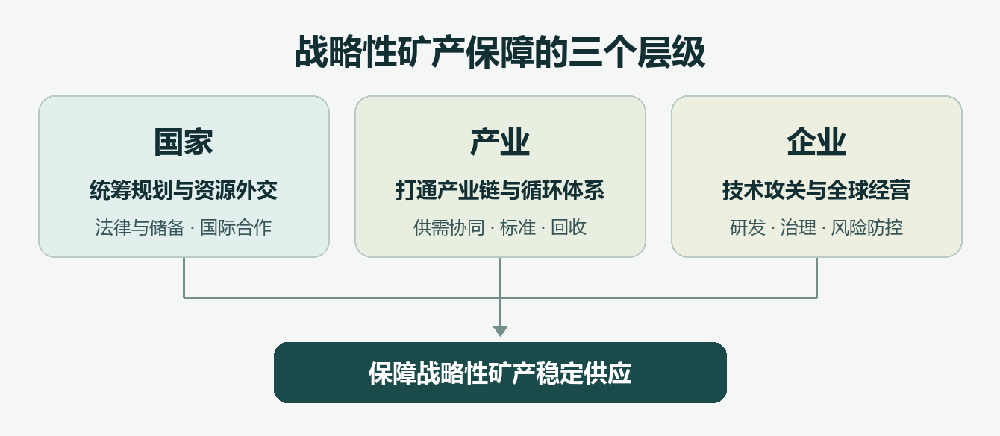
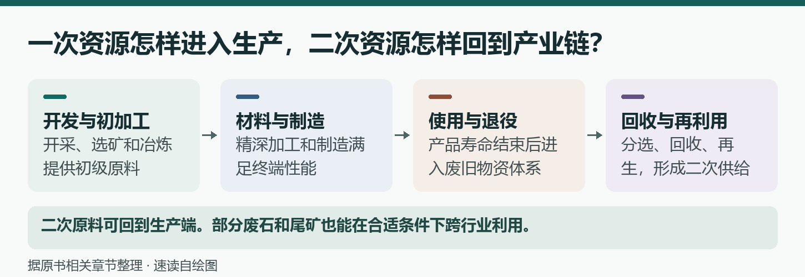

# 第九章 中国方略：建构路径与保障措施

[原书第九章](<../第九章-中国方略：建构路径与保障措施/第九章-中国方略：建构路径与保障措施.md>)

**作者的推理路线**　战略性矿产的风险会跨企业、跨环节和跨国传导，所以作者先问国家如何统筹，再问产业链怎样协同，最后问企业靠什么把制度安排变成实际供给。

图将原书的三个层级并排放在一起。国家提供规则和协调，产业链组织供需与标准，企业承担研发、经营和交付。

## 一、国家怎么统筹｜为什么制度、储备和外交要一起看？

**先把风险找出来。** 国家的名录要随技术、产业和国际形势调整。高风险矿种可以有专门的勘查、资金和扶持安排。跨部门数据平台把产能、贸易、价格和政策信息放到同一视野里，才有可能提前判断供应风险。

**储备分工解决不同冲击。** 国家储备用来应对极端情况，重点生产或使用企业按责任承担一定储备，商业储备则由市场主体按经营需要安排。原书还提出探索矿产地储备。读这一段时尤其要分清「现在可调拨的物资」与「为未来保留的矿产地」。

**对外拓展供应选择。** 作者把政府间资源合作、企业海外权益和长协采购、国际规则参与以及跨境运输通道放在一节。几项措施配合起来，潜在矿源才能通过稳定项目和可用运输转成实际供给。

## 二、产业链怎么协同｜为什么开采、加工、应用和回收都要管？

原书指出，某些矿产在中国呈现「中间强、两头弱」的格局，冶炼强，上游资源和下游高端材料仍有堵点。于是上游要做勘查和权益获取，中游推进绿色、智能采选冶，下游提高材料加工与应用能力。产业集群有助于配套，标准能让不同企业在质量、性能和环保要求上衔接。

书中接着把视角转到**需求侧和循环**。生态设计有助于延长使用寿命，废电池、废磁材回收可以扩大二次供给。采矿废石、尾矿、冶炼废渣也可以在合适条件下变成建材、填充料或再提取有价元素。作者从中说明，二次资源可以在产业链内部回流，也可能跨行业利用。

## 三、企业怎么落地｜做大以后还要补哪些能力？

顶层设计和产业协同最终需要企业执行。作者提出，让企业联动高校、科研机构，攻关深地探测、复杂矿分选、高值再生等环节，用中试和生产线把成果接进实际应用。世界一流企业还要有人才、治理、本地经营和全球配置能力，并通过尽职调查、保险和内部标准管理市场、政治与环境风险。

**读完能复述什么？** 国家为供应稳定建立制度，产业把一次供给、应用和循环串起来，企业把资源与技术转成持续交付。作者用三个层级解释了保障措施为什么要配套推进。
