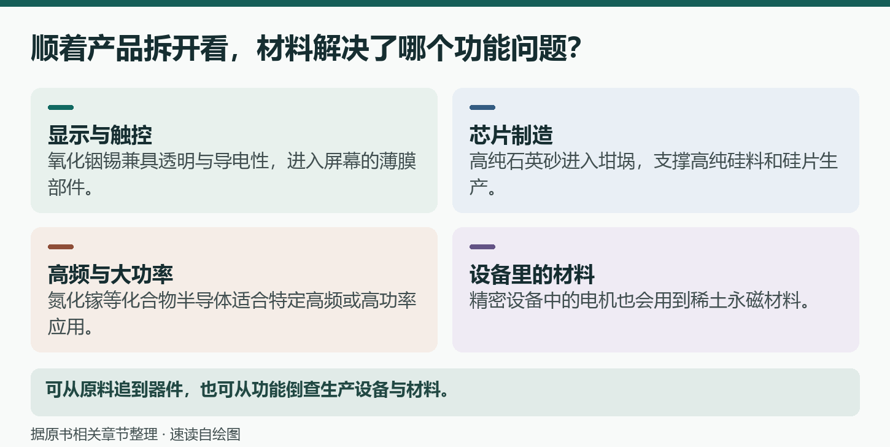
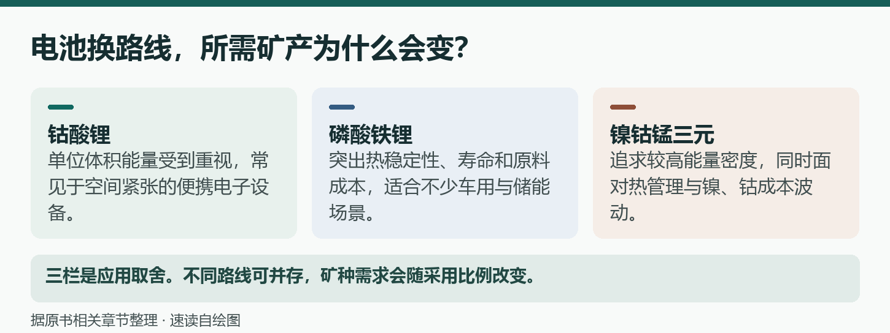

# 第二章 关键应用：无处不在的战略性矿产

[原书第二章](<../第二章-关键应用：无处不在的战略性矿产/第二章-关键应用：无处不在的战略性矿产.md>)

**作者的推理路线**　从一部手机里的矿产说起，追到制造时需要的性能，再看能源技术换路线时如何重排需求，最后把同一逻辑放回环保、日常生活和国防。

## 一、从手机拆起｜矿产的价值怎样变成产品的性能？

书中引述一部 iPhone 4S 的检测结果，其中有 **33 克铁、6 克铜、36 毫克金**。这些数字让读者先看到具体的材料构成。接下来的问题是，哪种材料在什么位置发挥作用，缺了它会失去哪种功能？

- **从屏幕看铟。** 氧化铟锡兼具透明和导电性，适合用在显示和触控部件上。把「用铟」再往下追一层，就能看见真正要满足的是透光与导电两项条件。
- **从芯片看制造链。** 高纯硅片是基材，高纯石英砂还用在熔炼硅料的坩埚。高频和大功率应用又给氮化镓等材料提供了空间。在芯片以外，光刻、刻蚀设备中的精密电机也用到稀土永磁材料。
- **从高端装备看工况。** 原书铺开海洋工程、智能制造和新材料，是为了说明耐蚀、耐高温、导热、轻量化等要求，会把选择限定到特定材料上。

这就是作者用「工业味精」作比的理由。掌握材料在哪一环发挥作用，才好继续判断当应用放量时，哪些矿产需求会增加。

## 二、从零件到产业｜为什么能源转型会重排矿产需求？

原书表 2-1 按应用列需求。电动汽车和储能电池对锂、钴、镍等要得多，风能看重铜和稀土，氢能中的镍和铂族金属也很重要。作者进一步用**电池正极路线**说明，同样叫电池，性能和成本的取舍一变，所需矿产就会变化。

钴酸锂适合重视单位体积能量的便携设备。磷酸铁锂把安全、循环寿命和成本放在更突出的位置。镍钴锰三元材料看重较高能量密度，因而更受镍、钴价格与热管理约束。固态电池在书中属于从实验室走向商业应用的路线，仍要留意产业化条件。

书中引用国际能源署 2025 年展望，预计 **2035 年全球锂需求约为 370 万吨锂当量**。理解这个预测时，要同时看到车用电池推广会抬高总需求，正极路线变化也会改变不同矿种承受的压力。风光发电又需要储能来平滑供电波动，风机、光伏组件和电网各有材料需求，因而形成多条同时增长的用矿路径。

## 三、回到日常｜为什么这些材料也关系到公共生活？

作者把同一判断方法用到环保和民生。尾气催化需要铂、钯、铑等材料发挥催化作用，工业过滤看重含氟材料的耐腐蚀和滤膜性能。节能家电靠永磁电机提高效率，钛合金因耐腐蚀和生物相容性被用于植入物。国防装备对轻量、耐高温和可靠性的要求，也把先进材料的性能推到更重要的位置。

**读完能复述什么？** 从具体产品出发，先查材料的功能，再查制造环节和替代路线。产品需求增加和技术路线改变，是作者解释矿种需求变化的两条线索。
