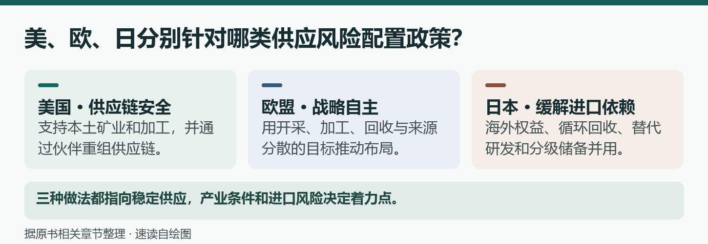
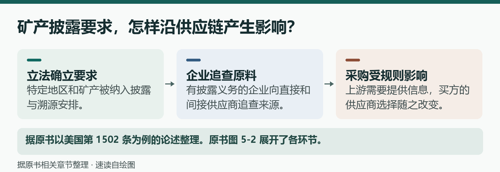

# 第五章 地缘博弈与战略性矿产的大国布局

[原书第五章](<../第五章-地缘博弈与战略性矿产的大国布局/第五章-地缘博弈与战略性矿产的大国布局.md>)

**作者的推理路线**　高端制造和低碳转型抬高矿产的重要性 → 美、欧、日依据自己的风险设计制度 → 「冲突矿产」展示制度如何影响境外供应商 → 归纳各方策略趋同和中国面临的压力。

## 一、从产业需求转向国家布局｜为什么各地都在做清单？

新材料提供特定性能，电动汽车、风电和电网又让相关用量扩大。需求增长一旦遇上供应集中，产业问题就会变成国家层面的供应风险。各方都在动态调整清单，共同关心的是现有产业最怕哪一环断掉。

**美国**强调供应链安全，政策重心由传统储备和市场采购扩展到扶持本土生产、审查供应风险和伙伴协作。**欧盟**把绿色转型、战略自主与来源多元化放在一起，通过《关键原材料法案》把部分目标量化。按原书表 5-2，**2030 年**本土开采、加工、回收能力目标分别为年度消费量的 **10%、40%、25%**，相关价值链任一阶段来自单一第三国的供应占比目标上限为 **65%**。**日本**面对进口依赖，把海外开发、循环回收、替代研发与战略储备纳入长期体系，政府及相关机构与企业财团配合，保供与先进材料研发一起推进。

## 二、转向「冲突矿产」｜为什么规则会沿采购链传到海外？

原书以刚果（金）及周边地区为例，指出部分矿产贸易会给当地武装冲突提供收入。在这个背景下，美国《多德—弗兰克法案》第 1502 条把相关地区的锡、钽、钨、金纳入披露与溯源安排。作者由此观察到，上市公司要交代材料从何处而来，上游供应商也得能提供来源信息。这样，一个国内制度就会影响跨国采购。

原书图 5-2 可用来补看政策、披露和上游影响的具体连接。书中还比较了欧盟把供应链尽责要求扩展到较广的冲突与高风险地区。作者用这个案例说明，控制供应链也包括设定标准、审核信息和影响采购选择。

## 三、回到中国｜策略相近，压力为什么来自不同地方？

主要经济体的清单在锂、钴、镍、稀土等矿种上高度重叠，也共同采用技术替代和回收、本土或友岸布局、储备和标准等安排。对中国的压力因此会分别出现在**供应链联盟、矿源与运输风险、海外项目政策变化、加工和材料技术替代**这四处。作者主张稳住资源供给，继续推进技术创新和循环利用，并参与全球规则制定。

**读完能复述什么？** 各方清单映射各自的供应弱点，政策工具改变企业和供应商的选择。作者借「冲突矿产」把这层制度影响讲具体，再解释为什么中国要同时看供给、技术和规则。
