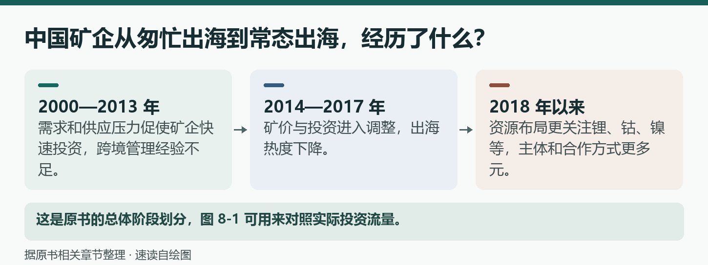

# 第八章 中国矿企走出去：披荆斩棘与扬帆远航

[原书第八章](<../第八章-中国矿企走出去：披荆斩棘与扬帆远航/第八章-中国矿企走出去：披荆斩棘与扬帆远航.md>)

**作者的推理路线**　先追问中国矿企为什么出海、什么时候从匆忙转向理性，再用五十强和国际案例查能力差距，最后按风险类型对应解决办法。

## 一、从投资曲线看｜中国矿企为什么换了一种出海方式？

**2000—2013 年，国内原料需求和供应压力使出海加速。** 并购能比较快取得矿源，但一批企业缺少跨境经营和项目管理经验。**2014—2017 年，矿价与投资遇到调整。** 国内需求增速放缓，又碰上前期产能释放，投资热度随之下降。**2018 年以来，出海走向常态。** 投资增加对锂、钴、镍等战略性矿产的关注，参与者扩展到电池和材料等民营企业，权益、合资和包销等方式的搭配更灵活。

看原书图 8-1 时，可从 2013 年高点一路看到 2017 年负值，再看 2018 年后的回升。图记录的是资金**流量**。原书将 2017 年负值与境外企业增加归还境内投资主体的股东贷款联系起来。

## 二、排名揭示什么？为什么要看资源、金融和贸易三种能力？

原书表 8-1 的 **2025 年二季度**五十强里，有 **9 家中国企业，合计市值 1,953 亿美元**，其中紫金矿业排名第四。作者还比较了主要矿种构成，指出部分企业的业务结构仍较集中。澳大利亚、加拿大和瑞士的案例，分别给出了矿业巨头成长的三种条件。

- **澳大利亚对应矿源。** 优质且多样的矿产可以支撑大规模专业开采。
- **加拿大对应金融。** 面向长周期、高风险矿业项目的资本市场，可为企业从勘探到扩张提供阶段性融资。
- **瑞士的嘉能可对应贸易网络。** 从交易和客户渠道进入，再通过并购扩展上游生产。作者借它说明，交易能力也能成为整合矿山的起点。

## 三、能力差距放进具体项目，风险如何处理？

**地缘政治和区位风险**会影响矿区和运输，国家可提供预警和外交支持，企业加强本地化运营和合作。**东道国政策与合规风险**需要贯穿投资前和运营中。书中墨西哥索诺拉锂项目的特许权变化说明，规则风险在取得项目后仍然存在。**经济波动和市场竞争风险**则要通过效率、成本、财务和供应链管理应对。原书建议大型企业视条件向上下游延伸，中小企业可以共享采购、运输或谈判能力。

**读完能复述什么？** 作者用三个出海阶段解释为什么投资方式变了，用三个国际案例说明巨头凭什么做大，最后把海外项目能否持续经营拆成三类风险来处理。
