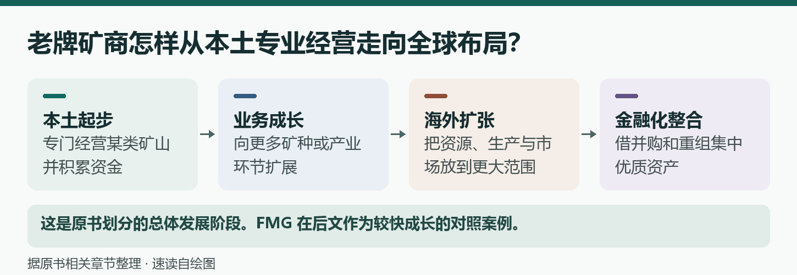
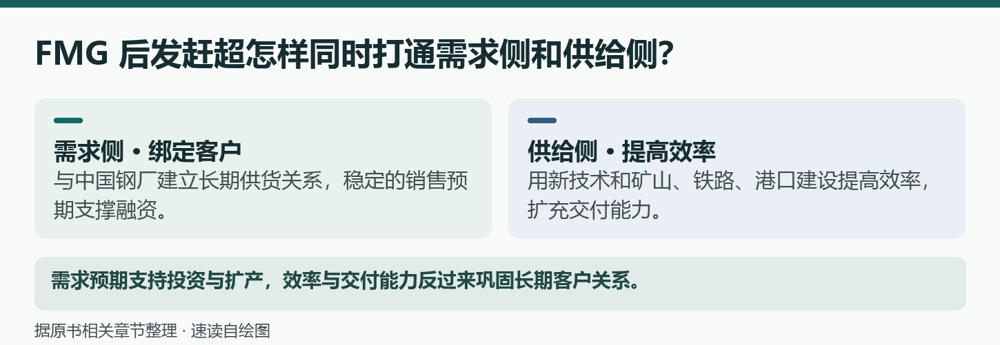

# 第六章 全球四大矿商：资本高手与顶级玩家

[原书第六章](<../第六章-全球四大矿商：资本高手与顶级玩家/第六章-全球四大矿商：资本高手与顶级玩家.md>)

**作者的推理路线**　从四大矿商的成长史找规律，再拆开矿源、资本、物流和销售的配合方式，以 FMG 验证后发者怎样打开局面，最后落到中国矿企可以积累的能力。

## 一、为什么先讲「发家史」？

必和必拓、力拓和淡水河谷有很长的经营史，FMG 成立较晚，聚焦铁矿石。作者把老牌矿商的发展放进工业化与全球化中理解。本土专业经营先积累资本，进入更多业务后再以跨国开发扩大规模。随后，并购重组把分散的优质资产集中起来。

历史为下面的判断提供了依据。按原书表 6-3 使用的 **2020 年产量排名**，全球前十大铁矿山有九座由四大矿商控制。高品位矿、大规模生产和成熟物流共同提供成本与交付优势，让部分矿山的供给变化足以影响市场。

## 二、矿山拿到手以后｜经营能力怎样扩大资源优势？

**并购解决进入速度。** 已有项目、产能和客户可以随资产取得。2001 年必和必拓和比利顿的合并，是原书观察从同业竞争走向大规模整合的案例。

**一体化解决衔接。** 从矿山到采选冶、铁路、港口和销售，环节接起来，才能控制到岸成本和交付。多矿种经营有助于分散波动，但作者也提到，企业会剥离缺乏竞争力的业务，把资金和管理集中到优势矿种。

**合资解决长期风险和能力缺口。** 矿业投资大、回收期长。矿商可以与伙伴分担投入，也可以借助伙伴的市场或运营能力。原书列举的西澳威拉拉铁矿合作，把上游矿源和中国钢企的购买需求连了起来。

## 三、为什么再用 FMG 做对照？

FMG 于 **2003 年成立，2008 年发运第一船铁矿石**。相较老牌矿商，它在矿源、规模和资金上起步较晚，因此先把中国钢厂变成长期客户，让稳定的销售预期为融资和扩产提供支撑。金融危机期间，华菱钢铁的股权投资进一步提供资金。供给侧再用采矿、铁路和港口技术提高效率，才有能力兑现供货。

原书由此把后发路径概括为「绑定下游」加「技术武装」。推到中国企业的实践上，作者主张拓展全球矿源、延伸产业链、运用融资及避险工具、提高技术和标准能力，并把绿色生产和社区关系纳入长期运营。人才整合与本地化决定了并购后能否长期经营。

**读完能复述什么？** 四大矿商用优质矿源起势，凭资本、物流和客户把资源优势变成可持续的交付能力。FMG 说明，后来者也可以从客户和技术先切入，再把规模做起来。
