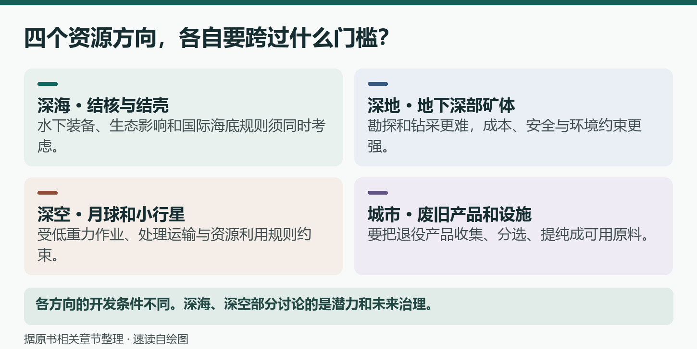
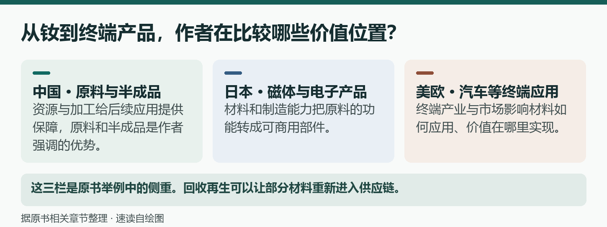

# 第十章 未来展望：我们的矿产向深海、向深地、向深空、向城市

[原书第十章](<../第十章-未来展望：我们的矿产向深海、向深地、向深空、向城市/第十章-未来展望：我们的矿产向深海、向深地、向深空、向城市.md>)

**作者的推理路线**　先把视线从传统矿山移向四类资源空间，再问潜在资源怎样变成可用材料，最后解释为什么开发、产业与全球治理要一起考虑。

## 一、四个方向｜发现潜力之后，各地要跨过什么门槛？

**深海**涉及多金属结核、富钴结壳和块状硫化物。书中把深水装备、生态影响和国际规则放在一起，因为勘探能力、环境评估与规则都约束商业开发。**深地**以深部矿体为对象，主要难点是找不准、钻得深、成本高。原书借地球物理勘探、深钻与智能开采说明技术能解决哪一部分问题。**深空**讨论月球和小行星的资源潜力，所涉开采、处理、运输和资源权属仍处于展望或探索阶段。

**城市矿山**把问题转向已有产品和设施。矿产进入经济系统后会在车辆、设备和建筑中形成存量，产品退役后才有一部分变成可回收的物质流。作者借这个区别说明，资源发现也可以发生在城市和产业存量中。

## 二、单看城市矿山｜大量废弃物怎样转成可用原料？

图 10-1 记录的是全球电子废弃物**年产生量**，从 **2010 年约 3,380 万吨**增至 **2022 年约 6,190 万吨**。作者借这个增长说明潜在回收来源在扩大。能收集多少、分出多少合格材料、回收成本能否承受，还要分别判断。

因此，原书一边谈拆解、分选和提纯，一边谈回收体系、生产者责任、质量标准和数字追溯。技术和制度要接起来，才能让废弃物流向合规处理，再把二次原料稳定送回生产。

## 三、从矿产到材料｜为什么竞争还会往下游走？

作者通过钕的应用比较各方优势。中国产业链在原料和半成品上有优势，日本在磁体和电子产品上有积累，美欧在汽车应用端也占有位置。这个例子把资源量、材料制备和终端市场拆开，让读者看到价值如何分布。

从这里，作者把保供延伸为全生命周期问题。原料要经过采选冶、材料制备和终端制造，产品使用后还可以经回收再进入供应链。替代材料、在用存量与正规回收体系共同为供给波动留出缓冲。

## 四、最后为什么落到资源治理？

资源开发受到能源和生态约束，矿产、能源与环境规划需要统筹。作者进一步提出，中国应在国际层面参与开发与贸易规则的制定，推动伙伴国形成更完整的产业能力，并以绿色治理和技术合作参与全球资源体系。

**读完能复述什么？** 四个方向开辟新的供给可能，材料技术决定资源能转成什么价值，规则和环境治理决定这种开发能否持久。
