# 范畴论下的设计模式

## From Design Patterns to Category Theory — 中英双语阅读指南 / Bilingual Reading Guide

> **原系列作者 / Original author:** Mark Seemann  
> **整理日期 / Compiled:** 2026-10-13（Asia/Shanghai）  
> **入口 / Series entry:** [From design patterns to category theory](https://blog.ploeh.dk/2017/10/04/from-design-patterns-to-category-theory/)  
> **范围 / Scope:** 入口文章 + 入口目录列出的 128 篇文章；六个主题分支。

这是按原系列目录组织的**原创学习整理**，不是全文转载或逐句翻译。每篇包含中文导读、对应英文摘要、原文链接、思考问题及该篇正文配图。解释、补充示例和阅读路线由整理者编写；原文观点与限定条件尽量在对应条目中说明。未收录评论区、页面侧栏、完整源码与诗文。阅读完整论证与代码时，请访问每篇原文。

This is an **original bilingual study companion**, arranged by the series catalogue, rather than a full reproduction or translation. Each entry contains a Chinese reading note, an English counterpart, a source link, a study question, and the article's body illustrations. Explanations, supplemental examples, and reading routes are editorial additions. Consult the linked originals for complete arguments and code.

配图保存在相邻的 `img/` 中，以原始图片文件代替屏幕截图，避免损失清晰度。图片内文字保留原样；每幅图下链接其来源。Markdown 使用相对图片路径，移动时请保持文档与 `img/` 的相对位置。标题、列表、引用、代码和图的位置参考博客的阅读层次；Markdown 不能保证在所有阅读器中复现原网页字体、栏宽与代码着色。

Illustrations are local original assets, preserving clarity better than screenshots. Embedded image text remains unchanged. Relative paths require keeping `img/` beside this document. Headings and code blocks preserve a readable hierarchy; exact typography depends on the Markdown viewer. Image rights remain with their respective rights holders.

> [!NOTE]
> 系列始于 2017 年，但目录持续更新，包含 2025 年文章。编号按**入口的主题次序**，不按发布时间。标题中的“范畴论”是整体学习方向；幺半群等首先属于抽象代数，不需要用范畴论才能解释。
>
> The series began in 2017 and its catalogue includes later additions through 2025. Numbers follow its topic order, not chronology. Several foundational concepts belong to abstract algebra and can be understood without a full course in category theory.

<a id="reading"></a>

## 如何阅读 / How to read

先读 A000 把握作者动机，然后选择一条路线。中文与英文采用**紧邻段落对照**，而不是横向宽表；这更适合长文、手机和多数 Markdown 阅读器。每篇编号如 `A036`，后续提问可直接引用编号与小节。

Begin with A000, then choose a route. Chinese and English notes appear in adjacent paragraphs for comfortable long-form reading. Use identifiers such as `A036` when asking follow-up questions.

| 路线 / Route | 建议次序 / Suggested order | 目标 / Goal |
|---|---|---|
| 基础入门 / Foundations | A000 → A001 → A002 → A004 → A009 → A012 → A013 → A015 | 理解封闭、结合、单位与累积 / Understand closure, associativity, identity, reduction |
| 熟悉 C# 与 LINQ / From C# and LINQ | A021 → A022 → A037 → A041 → A065 → A067 → A068 → A069 | 把 Select 与 SelectMany 放进统一模型 / Connect projection and sequencing |
| 从模式出发 / From patterns | A115 → A116 → A119 → A120 → A121 → A122；遇到陌生概念回看前置条目 | 为已知模式补上法则 / Add laws to familiar patterns |
| 状态与效果 / State and effects | A032 → A074 → A123 → A124 → A125；再读 A073、A077、A085 | 分离状态数据、计算与执行 / Separate state, computation, execution |
| 接口与兼容 / Contracts | A051 → A055 → A058 → A059 → A126 → A127 → A128 | 看清输入输出的适配方向 / Understand adaptation directions |
| 完整路线 / Full route | 按目录逐篇，允许先略过 Fix 与 F-algebra 推导，再回读 | 建立完整词汇 / Build the full vocabulary |

不必在第一遍掌握每一个实现。为每个结构记录三件事：**数据或计算的形状、可用操作、必须成立的法则**。遇到测试，再问测试展示了什么，哪些输入、效果或相等定义尚未覆盖。

On a first pass, record each structure's **shape, operations, and laws**. For a test example, distinguish the cases demonstrated from a universal proof, and identify unexamined assumptions about inputs, effects, and equality.

<a id="quickref"></a>

## 核心术语与法则 / Terms and laws at a glance

下表是便于回看的概念索引；类型箭头是示意签名，不是可直接编译的 C#。`id` 表示恒等函数，`∘` 表示复合，`⊕` 表示选定的二元运算，`≅` 表示拟讨论的同构。

This table is a compact conceptual index. Arrows are illustrative type signatures. `id` denotes identity, `∘` composition, and `⊕` a specified combination operation. Concrete implementations must define equality and execution semantics.

| English | 中文 | 形状与关键约束 / Shape and constraints | 对应条目 |
|---|---|---|---|
| Magma | 原群 | `T × T → T`；封闭 / Closure | A017–A019 |
| Semigroup | 半群 | 封闭且结合 / Closure and associativity | A013–A015 |
| Monoid | 幺半群 | 半群 + 左右单位元 / Semigroup plus two-sided identity | A002–A012 |
| Quasigroup | 拟群 | 左右方程各有唯一解 / Unique solutions on both sides | A016 |
| Endomorphism | 自同态 | `T → T`；以复合形成幺半群 / Monoid under composition | A009、A061 |
| Functor | 函子 | `(A → B) → F<A> → F<B>`；恒等与复合 / Identity and composition | A021–A036 |
| Applicative | 应用函子 | `pure: A → F<A>`；`apply: F<A→B> → F<A> → F<B>` | A037–A046 |
| Bifunctor | 双函子 | 同时映射两个参数 / Map two parameters consistently | A047–A050 |
| Contravariant functor | 逆变函子 | `(B → A) → C<A> → C<B>` | A051–A057 |
| Profunctor | 此处保留英文术语 | `(C → A)` 与 `(B → D)` 适配 `P<A,B>` 为 `P<C,D>` | A058–A059 |
| Invariant functor | 不变函子 | 同时提供正向与反向转换 / Supply transformations both ways | A060–A064 |
| Monad | 单子；正文保留 Monad | `bind: M<A> → (A → M<B>) → M<B>`；单位与结合 | A065–A078 |
| Natural transformation | 自然变换 | 对各 A 统一转换 `F<A> → G<A>`，与 map 相容 | A080 |
| Traversal | 遍历 | `T<F<A>> → F<T<A>>`；T 可遍历、F 为 Applicative | A084 |
| Isomorphism | 同构 | 双向转换，往返恢复原值 / Inverse representation changes | A086–A096 |
| Church encoding | Church 编码 / 丘奇编码 | 以消去行为表示数据 / Represent data through consumption | A097–A103 |
| Catamorphism | 结构归约；也译降态射 | 按构造结构消去数据 / Eliminate data by its constructors | A104–A114 |

### 一页法则卡 / A compact law card

**二元组合 / Binary combination**（A002、A013）：

```text
Closure / 封闭:       x ⊕ y ∈ T
Associativity / 结合: (x ⊕ y) ⊕ z = x ⊕ (y ⊕ z)
Identity / 单位:      e ⊕ x = x = x ⊕ e
```

结合律只改变括号；交换律 `x ⊕ y = y ⊕ x` 才允许换序。幺半群不要求交换律。

Associativity changes grouping. Commutativity changes order and is not a monoid requirement.

**映射 / Mapping**（A021）：

```text
map(id, fa) = fa
map(g, map(f, fa)) = map(g ∘ f, fa)
```

**Monad 串联 / Sequencing**（A067）：

```text
bind(pure(a), f) = f(a)
bind(ma, pure) = ma
bind(bind(ma, f), g) = bind(ma, a => bind(f(a), g))
```

**自然性 / Naturality**（A080）：

```text
nt(map_F(f, fa)) = map_G(f, nt(fa))
```

**同构往返 / Isomorphism round trips**（A086）：

```text
from(to(a)) = a
to(from(b)) = b
```

这些等式用的是结构所选择的语义相等。对函数可能要比较所有输入的结果；对任务或流还需说明可观察的执行行为。有限的单元测试与性质测试能找到错误、增加信心，但不自动构成数学证明。

These equations use the relevant semantic equality. Functions require a behavioral comparison; tasks and streams may involve observable execution. Finite testing provides evidence and counterexamples, not an automatic universal proof.

### map、apply、bind 的选择 / Choosing map, apply, or bind

| 当前需要 / Need | 使用 / Use | 小例子 / Small example |
|---|---|---|
| 转换一个已有结构中的值 / Transform one wrapped value | map | `Maybe<string>` → `Maybe<int>` |
| 组合结构预先确定的输入 / Combine independently specified inputs | apply / lift | 可选名字与可选年龄 → 可选用户 / Optional name and age → optional user |
| 下一步结构由上一步结果决定 / Choose the next computation from a result | bind | 解析结果 → 依该结果发起查询 / Parse, then select a query |

这是使用上的判断法，**“独立”不等于“并行”，“串联”不等于“可变状态”**。执行策略由实例与具体操作决定。

This is a usage heuristic. **Independence does not promise parallelism; sequencing does not imply mutation.** Instances and operators determine execution policy.

### 系列的学习脉络 / The learning connections

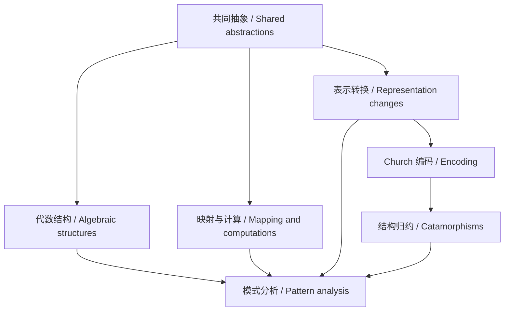

*此图为整理者补充；不支持 Mermaid 的阅读器会显示源码。文字路线：基础组合与映射 → 表示转换及结构归约 → 设计模式分析。*

*Editorial diagram. A viewer without Mermaid support will show its source. In words: composition and mapping foundations lead through representation and elimination to pattern analysis.*

<a id="pattern-map"></a>

## 设计模式对应速查 / Pattern relationship index

| 模式或原则 / Pattern or principle | 本系列的视角 / Perspective | 阅读时的条件 / Conditions to inspect |
|---|---|---|
| Composite | 结果聚合、First 或自同态复合 / Result aggregation, First, endomorphism composition | 接口粒度、运算、空行为、效果与顺序 / Operation, empty behavior, effects, order；A116–A118 |
| Null Object | 组合的单位行为 / Identity behavior | 对指定组合确实中立 / Neutral under the specified combination；A119 |
| Builder | 构建状态上的自同态 / Endomorphisms over construction state | 状态与修改语义、默认值、顺序 / State, defaults, order；A120 |
| Visitor | 和类型的对象表示 / Object-oriented representation of alternatives | 固定分支及完整消去接口 / Fixed cases and complete elimination；A121 |
| Chain of Responsibility | 列表归约 + Maybe 消去 / List reduction plus optional elimination | 首结果规则与 I/O 短路 / First-result rule and short-circuiting；A122 |
| State pattern | 多态 + 显式状态计算 / Polymorphism plus explicit state computations | 有无独立返回结果、如何执行效果 / Outputs and effects；A123–A125 |
| Postel / LSP / compatibility | 输入输出方向的 Profunctor 视角 / Profunctor perspective on contract direction | 前后置条件及真实可观察行为 / Contracts and observations；A126–A128 |

> [!IMPORTANT]
> **四个要带着读的限定 / Four qualifications to retain:** A036 有作者补记，不能将其标题作为“数学集合不是函子”的定理；A046 的推广以猜想收尾；A095 明确否认 Result 与异常严格同构；A125 的复杂重构用于教学，作者仍偏好该例原先简单的生产实现。
>
> Retain the postscript in A036, the conjectural generalization in A046, the rejection of a strict isomorphism in A095, and the pedagogical purpose of the elaborate refactoring in A125.

<a id="catalogue"></a>

## 完整目录 / Complete catalogue

以下顺序与入口目录一致。每个编号都有独立导读；分支总览也作为文章保留。

The order matches the entry catalogue. Branch overviews are included as articles with their own reading notes.

- [阅读路线 / Reading routes](#reading)
- [术语与法则 / Terms and laws](#quickref)
- [模式对应 / Pattern index](#pattern-map)
- [补充练习 / Exercises](#examples)
- [提问模板 / Follow-up questions](#questions)

- [A000 · 从设计模式到范畴论](#a000)
- [A001 · 幺半群、半群及相关结构](#a001)
  - [A002 · 幺半群](#a002)
    - [A003 · 角度加法幺半群](#a003)
    - [A004 · 字符串、列表与序列幺半群](#a004)
    - [A005 · 货币幺半群](#a005)
    - [A006 · 凸包幺半群](#a006)
    - [A007 · 元组幺半群](#a007)
    - [A008 · 函数幺半群](#a008)
    - [A009 · 自同态幺半群](#a009)
    - [A010 · Maybe 幺半群](#a010)
    - [A011 · Lazy 幺半群](#a011)
    - [A012 · 幺半群的累积](#a012)
  - [A013 · 半群](#a013)
    - [A014 · 包围盒半群](#a014)
    - [A015 · 半群的累积](#a015)
  - [A016 · 拟群](#a016)
  - [A017 · 原群（Magma）](#a017)
    - [A018 · 石头剪刀布原群](#a018)
    - [A019 · 颜色混合原群](#a019)
- [A020 · 函子、应用函子及相关结构](#a020)
  - [A021 · 函子](#a021)
    - [A022 · Maybe 函子](#a022)
    - [A023 · Either 的单参数函子视角](#a023)
    - [A024 · 树函子](#a024)
    - [A025 · 玫瑰树的函子视角](#a025)
    - [A026 · Visitor 函子](#a026)
    - [A027 · 响应式函子](#a027)
    - [A028 · Identity 函子](#a028)
    - [A029 · Lazy 函子](#a029)
    - [A030 · 异步函子](#a030)
    - [A031 · Const 函子](#a031)
    - [A032 · State 函子](#a032)
    - [A033 · Reader 函子](#a033)
    - [A034 · IO 函子](#a034)
    - [A035 · 单态函子](#a035)
    - [A036 · Set 不是函子？——须结合勘误阅读](#a036)
  - [A037 · 应用函子](#a037)
    - [A038 · 完整的一副牌](#a038)
    - [A039 · 应用式密码列表](#a039)
    - [A040 · 函数的应用式组合](#a040)
    - [A041 · Maybe 应用函子](#a041)
    - [A042 · 应用式验证](#a042)
    - [A043 · 测试数据生成器应用函子](#a043)
    - [A044 · F# 中的丹麦个人编号](#a044)
    - [A045 · Lazy 应用函子](#a045)
    - [A046 · 应用函子中的幺半群——推广猜想](#a046)
  - [A047 · 双函子](#a047)
    - [A048 · 元组双函子](#a048)
    - [A049 · Either 双函子](#a049)
    - [A050 · 玫瑰树双函子](#a050)
  - [A051 · 逆变函子](#a051)
    - [A052 · 命令处理器逆变函子](#a052)
    - [A053 · Specification 逆变函子](#a053)
    - [A054 · 等价关系逆变函子](#a054)
    - [A055 · Reader 的逆变视角](#a055)
    - [A056 · 函子变型与 C# 变型](#a056)
    - [A057 · 逆变依赖注入](#a057)
  - [A058 · Profunctor（输入逆变、输出协变）](#a058)
    - [A059 · Reader 的 Profunctor 视角](#a059)
  - [A060 · 不变函子](#a060)
    - [A061 · 自同态不变函子](#a061)
    - [A062 · 自然变换的不变函子视角](#a062)
    - [A063 · 普通函子的不变视角](#a063)
    - [A064 · 逆变函子的不变视角](#a064)
  - [A065 · Monad](#a065)
    - [A066 · Kleisli 复合](#a066)
    - [A067 · Monad 法则](#a067)
    - [A068 · 列表 Monad](#a068)
    - [A069 · Maybe Monad](#a069)
    - [A070 · Either Monad](#a070)
    - [A071 · Identity Monad](#a071)
    - [A072 · Lazy Monad](#a072)
    - [A073 · 异步 Monad](#a073)
    - [A074 · State Monad](#a074)
    - [A075 · Reader Monad](#a075)
    - [A076 · 响应式 Monad](#a076)
    - [A077 · IO Monad](#a077)
    - [A078 · 测试数据生成器 Monad](#a078)
  - [A079 · 函子之间的关系](#a079)
    - [A080 · 自然变换](#a080)
    - [A081 · 函子积](#a081)
    - [A082 · 函子和](#a082)
    - [A083 · 函子复合](#a083)
    - [A084 · 遍历与顺序交换](#a084)
    - [A085 · 嵌套 Monad](#a085)
- [A086 · 软件设计同构](#a086)
  - [A087 · Unit 同构](#a087)
  - [A088 · 函数同构](#a088)
  - [A089 · 参数列表同构](#a089)
  - [A090 · 柯里化与反柯里化同构](#a090)
  - [A091 · 对象同构](#a091)
  - [A092 · 抽象类与依赖注入同构](#a092)
  - [A093 · 继承与组合同构](#a093)
  - [A094 · Tester–Doer 同构](#a094)
  - [A095 · Result 与异常：并非严格同构](#a095)
  - [A096 · Builder 的多种同构表示](#a096)
- [A097 · Church 编码](#a097)
  - [A098 · Church 编码的布尔值](#a098)
  - [A099 · Church 编码的自然数](#a099)
  - [A100 · Church 编码的 Maybe](#a100)
  - [A101 · Church 编码的 Either](#a101)
  - [A102 · Church 编码的支付类型](#a102)
  - [A103 · Church 编码的玫瑰树](#a103)
- [A104 · Catamorphism（结构归约）](#a104)
  - [A105 · 布尔 Catamorphism](#a105)
  - [A106 · Peano Catamorphism](#a106)
  - [A107 · Maybe Catamorphism](#a107)
  - [A108 · 列表 Catamorphism](#a108)
  - [A109 · NonEmpty Catamorphism](#a109)
  - [A110 · Either Catamorphism](#a110)
  - [A111 · 树 Catamorphism](#a111)
  - [A112 · 玫瑰树 Catamorphism](#a112)
  - [A113 · 满二叉树 Catamorphism](#a113)
  - [A114 · 支付类型 Catamorphism](#a114)
- [A115 · 把部分设计模式视作通用抽象](#a115)
  - [A116 · Composite 的幺半群视角](#a116)
    - [A117 · 合并回退型 Composite](#a117)
    - [A118 · 自同态型 Composite](#a118)
  - [A119 · Null Object 作为单位元](#a119)
  - [A120 · Builder 的幺半群视角](#a120)
  - [A121 · Visitor 作为和类型](#a121)
  - [A122 · 责任链作为 Catamorphism 组合](#a122)
  - [A123 · State 模式与 State Monad](#a123)
    - [A124 · 把 TCP State 示例重构成纯函数](#a124)
    - [A125 · 把 Saga 从 State 模式重构到 State Monad](#a125)
  - [A126 · Postel 法则的 Profunctor 视角](#a126)
  - [A127 · 里氏替换原则的 Profunctor 视角](#a127)
  - [A128 · 向后兼容的 Profunctor 视角](#a128)

---

## 逐篇双语导读 / Article-by-article bilingual notes

正文中的“中文 / 中文导读”与“English”是整理者对文章的概括，不是作者逐句原文。配图则来自原文正文，权利归原作者或相应权利人；可通过图注访问来源。

The Chinese and English paragraphs below are editorial summaries. The illustrations are original body assets with linked provenance; rights remain with their respective owners.

<a id="a000"></a>

#### A000 · 从设计模式到范畴论

*From design patterns to category theory*

[原文 / Source](https://blog.ploeh.dk/2017/10/04/from-design-patterns-to-category-theory/) · 发布日期 / Published: 2017/10/04

**中文导读**

熟悉的抽象让陌生代码变得可读。设计模式提供共同词汇，但变体与实现偏差会造成歧义；具有明确法则的数学结构，可进一步约束组合行为。本系列尝试以面向对象经验为入口，建立通往函数式设计的学习路径。

**English**

Shared abstractions make unfamiliar code easier to understand. Mathematical laws can sharpen the vocabulary supplied by design patterns. The series connects familiar object-oriented techniques with functional structures through examples and refactorings.

**思考 / Study question**

一个模式名称还缺少哪些行为保证？ / What guarantees does a pattern name leave unspecified?

**原文配图 / Original illustrations**

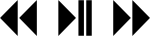

*A000 · 图 1 / Figure 1 · [图片来源 / Image source](https://blog.ploeh.dk/content/binary/playback-controls.png)*

[返回目录 / Back to catalogue](#catalogue)

---

### 第一部分：代数结构 / Part I: Algebraic structures

<a id="a001"></a>

#### A001 · 幺半群、半群及相关结构

*Monoids, semigroups, and friends*

[原文 / Source](https://blog.ploeh.dk/2017/10/05/monoids-semigroups-and-friends/) · 发布日期 / Published: 2017/10/05

**中文导读**

先观察一个操作是否把两个同类值合成一个同类值，再检查结合律与单位元。DDD 中的“操作闭包”可借这些结构得到更精确的描述。这里讨论的主要是抽象代数，不必先学完整的范畴论。

**English**

Start with an operation that combines two values of one type. Associativity and an identity then distinguish useful algebraic structures. This vocabulary gives a precise account of operation closure in domain models.

**思考 / Study question**

为什么返回类型相同仍不够？ / Why is a matching return type insufficient?

**原文配图 / Original illustrations**

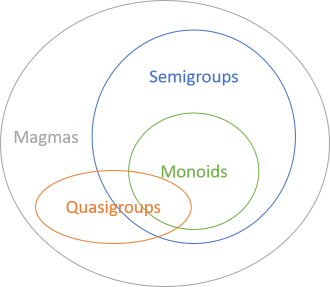

*A001 · 图 1 / Figure 1 · [图片来源 / Image source](https://blog.ploeh.dk/content/binary/magmas-quasigroups-semigroups-monoids.png)*

[返回目录 / Back to catalogue](#catalogue)

---

<a id="a002"></a>

##### A002 · 幺半群

*Monoids*

[原文 / Source](https://blog.ploeh.dk/2017/10/06/monoids/) · 发布日期 / Published: 2017/10/06

**中文导读**

幺半群由载体、封闭二元运算和单位元组成，并满足结合律与左右单位律。整数加法的单位元是 0，乘法的是 1；布尔 AND 与 OR 也各有一个单位元。不要把结合律误认为交换律。

**English**

A monoid packages a closed operation with an identity and associativity. Different operations on the same type yield different monoids. Addition, multiplication, conjunction, and disjunction illustrate why the operation must be named explicitly.

**思考 / Study question**

字符串拼接能交换顺序吗？ / Can concatenation exchange its operands?

**原文配图 / Original illustrations**

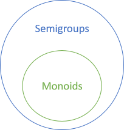

*A002 · 图 1 / Figure 1 · [图片来源 / Image source](https://blog.ploeh.dk/content/binary/monoids-subset-of-semigroups.png)*

[返回目录 / Back to catalogue](#catalogue)

---

<a id="a003"></a>

###### A003 · 角度加法幺半群

*Angular addition monoid*

[原文 / Source](https://blog.ploeh.dk/2018/07/16/angular-addition-monoid/) · 发布日期 / Published: 2018/07/16

**中文导读**

角度可在相加后按一周归一化，例如 350° 加 20° 得到 10°。零角度不改变结果，重新分组也不改变理想数学结果。实现时要说明角度表示、归一化和数值精度，不能只凭运算符名称判断法则。

**English**

Angles provide an everyday example of modular addition. A full-turn normalization keeps results within the chosen representation. Zero acts as identity, while implementation precision determines how faithfully the mathematical laws survive in code.

**思考 / Study question**

角度的相等应如何定义？ / How should angle equality be defined?

**原文配图 / Original illustrations**


*A003 · 图 1 / Figure 1 · [图片来源 / Image source](https://blog.ploeh.dk/content/binary/angle-45.png)*


*A003 · 图 2 / Figure 2 · [图片来源 / Image source](https://blog.ploeh.dk/content/binary/angle-45-90.png)*

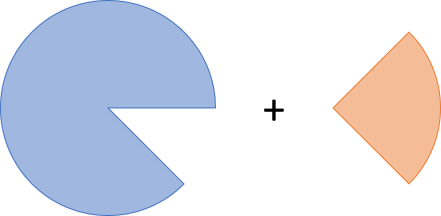

*A003 · 图 3 / Figure 3 · [图片来源 / Image source](https://blog.ploeh.dk/content/binary/angle-315-plus-90.png)*

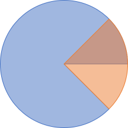

*A003 · 图 4 / Figure 4 · [图片来源 / Image source](https://blog.ploeh.dk/content/binary/angle-315-90.png)*

[返回目录 / Back to catalogue](#catalogue)

---

<a id="a004"></a>

###### A004 · 字符串、列表与序列幺半群

*Strings, lists, and sequences as a monoid*

[原文 / Source](https://blog.ploeh.dk/2017/10/10/strings-lists-and-sequences-as-a-monoid/) · 发布日期 / Published: 2017/10/10

**中文导读**

把两段序列接起来仍是序列，空序列是单位元；字符串可视为字符序列，因此具有同样的拼接结构。拼接保留先后次序。C# 的 null、可变集合及有副作用的枚举，需要另外处理，不能直接当作数学列表。

**English**

Concatenation supplies a common structure for strings and ordered collections. Empty values provide identities. The abstraction explains composition without erasing order; nulls, mutation, and effectful enumeration complicate an otherwise straightforward model.

**思考 / Study question**

空字符串与 null 是同一个概念吗？ / Is an empty string equivalent to null?

[返回目录 / Back to catalogue](#catalogue)

---

<a id="a005"></a>

###### A005 · 货币幺半群

*Money monoid*

[原文 / Source](https://blog.ploeh.dk/2017/10/16/money-monoid/) · 发布日期 / Published: 2017/10/16

**中文导读**

文章重新分析 Kent Beck 的多币种示例：先构造加法表达式，再由解释器按汇率求值。结合性依赖表达式所采用的相等判断，而非树形结构相同。开放接口的新实现仍可能破坏法则，金融精度也不能从教学整数模型直接推广。

**English**

The money example composes expressions before interpreting them in a target currency. Equality is evaluated through that interpretation. Its algebraic reading depends on the supported implementations and arithmetic assumptions, rather than on identical expression-tree shapes.

**思考 / Study question**

表达式相等与结构相等有何差别？ / How does interpreted equality differ from structural equality?

[返回目录 / Back to catalogue](#catalogue)

---

<a id="a006"></a>

###### A006 · 凸包幺半群

*Convex hull monoid*

[原文 / Source](https://blog.ploeh.dk/2017/10/23/convex-hull-monoid/) · 发布日期 / Published: 2017/10/23

**中文导读**

将两组凸包的点合并，再计算覆盖它们的凸包；单位元是空凸包。这不是直接返回两个多边形的集合论并集。文章用性质测试检查法则，并明确坐标范围限制：叉积发生整数溢出时，示例实现的保证会失效。

**English**

Combine hulls by computing a hull around their combined points. The empty hull supplies the identity. The example also exposes an implementation boundary: bounded integer arithmetic can undermine the intended geometric laws when cross products overflow.

**思考 / Study question**

数学运算成立时，代码为何仍可能失败？ / Why can code fail to preserve a mathematical law?

**原文配图 / Original illustrations**

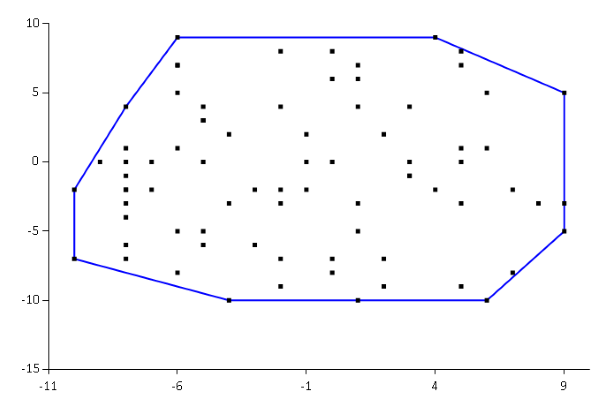

*A006 · 图 1 / Figure 1 · [图片来源 / Image source](https://blog.ploeh.dk/content/binary/convex-hull-example-01.png)*

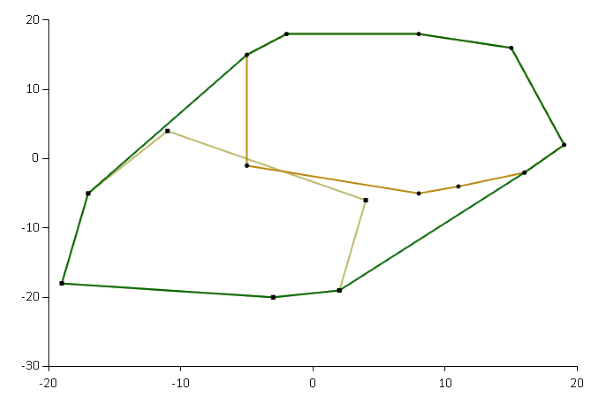

*A006 · 图 2 / Figure 2 · [图片来源 / Image source](https://blog.ploeh.dk/content/binary/convex-hull-union.png)*

[返回目录 / Back to catalogue](#catalogue)

---

<a id="a007"></a>

###### A007 · 元组幺半群

*Tuple monoids*

[原文 / Source](https://blog.ploeh.dk/2017/10/30/tuple-monoids/) · 发布日期 / Published: 2017/10/30

**中文导读**

若元组各分量已有幺半群结构，就逐分量组合，单位元也是各分量单位元组成的元组。可无损转换为元组的数据对象，同样能获得这种结构。关键是每个字段选择什么操作，而非对象看起来像一个记录。

**English**

Products inherit monoidal structure component by component. Records can use the same construction when represented faithfully as tuples. This lets a larger domain object obtain predictable combination rules from smaller, independently understood fields.

**思考 / Study question**

两个统计字段能用不同的合并操作吗？ / Can separate fields use different combination operations?

[返回目录 / Back to catalogue](#catalogue)

---

<a id="a008"></a>

###### A008 · 函数幺半群

*Function monoids*

[原文 / Source](https://blog.ploeh.dk/2017/11/06/function-monoids/) · 发布日期 / Published: 2017/11/06

**中文导读**

固定输入类型，若输出类型有幺半群结构，就能对两个函数的结果逐点组合：同一输入交给两函数，再合并输出。单位函数总返回输出类型的单位元。这里组合的是函数的结果，与下一篇的函数串联不同。

**English**

Functions returning monoidal values can be combined pointwise. Each receives the same input, and their outputs are merged. The identity is a constant function returning the output identity; this construction differs from sequential function composition.

**思考 / Study question**

逐点合并与函数串联有什么不同？ / How does pointwise combination differ from composition?

[返回目录 / Back to catalogue](#catalogue)

---

<a id="a009"></a>

###### A009 · 自同态幺半群

*Endomorphism monoid*

[原文 / Source](https://blog.ploeh.dk/2017/11/13/endomorphism-monoid/) · 发布日期 / Published: 2017/11/13

**中文导读**

一个 T→T 的函数可以接在另一个之后，组合结果仍是 T→T。函数复合满足结合律，恒等函数 x→x 是单位元。T 自身不需要能相加；文章用一系列时间调整说明这一点，且调整的次序通常不可交换。

**English**

Endomorphisms compose into a monoid even when their value type has no combining operation. Identity leaves its input untouched. Scheduling adjustments make the construction concrete and show why regrouping transformations differs from rearranging them.

**思考 / Study question**

先调整日期再调整时区能交换吗？ / Can date and timezone adjustments be reordered?

[返回目录 / Back to catalogue](#catalogue)

---

<a id="a010"></a>

###### A010 · Maybe 幺半群

*Maybe monoids*

[原文 / Source](https://blog.ploeh.dk/2018/04/03/maybe-monoids/) · 发布日期 / Published: 2018/04/03

**中文导读**

给半群加入一个“没有值”的状态，可用 Nothing 作为单位元，两个有值项沿用原运算。还可选择第一个或最后一个有值项形成不同幺半群。因此 Maybe 本身并未唯一指定合并策略，业务应明确选择。

**English**

Optional values support several combining rules. One extends a semigroup with an absent identity; others retain the earliest or latest present value. Naming the chosen operation matters because identical container types can encode very different behavior.

**思考 / Study question**

回退查询该保留第一个还是最后一个结果？ / Should fallback lookup keep the first or last result?

**原文配图 / Original illustrations**

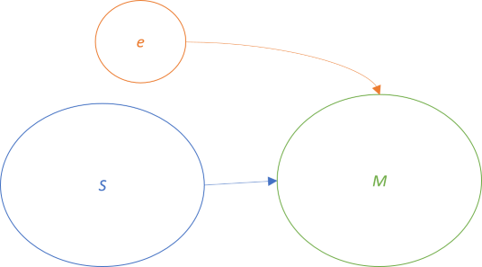

*A010 · 图 1 / Figure 1 · [图片来源 / Image source](https://blog.ploeh.dk/content/binary/semigroup-to-monoid.png)*

[返回目录 / Back to catalogue](#catalogue)

---

<a id="a011"></a>

###### A011 · Lazy 幺半群

*Lazy monoids*

[原文 / Source](https://blog.ploeh.dk/2019/04/15/lazy-monoids/) · 发布日期 / Published: 2019/04/15

**中文导读**

延迟值的组合可以继续保持延迟：需要最终结果时，再执行底层运算。文章逐个展示数字、布尔、角度、字符串和领域对象的例子，并连接到 Applicative。延迟计算的求值时机与缓存行为，属于实现语义的一部分。

**English**

Lazy wrappers can carry the combining rules of their underlying values. The operation constructs a deferred result, rather than forcing both inputs immediately. These examples prepare the later connection between monoidal values and applicative combination.

**思考 / Study question**

构造组合值时必须执行计算吗？ / Must combination construction evaluate its inputs?

[返回目录 / Back to catalogue](#catalogue)

---

<a id="a012"></a>

###### A012 · 幺半群的累积

*Monoids accumulate*

[原文 / Source](https://blog.ploeh.dk/2017/11/20/monoids-accumulate/) · 发布日期 / Published: 2017/11/20

**中文导读**

从单位元出发，对集合逐个应用组合运算，就能把任意有限数量的值归约为一个值。空集合也有结果，正是单位元。结合律允许改变括号分组，但不会自动允许重排元素，也不自动保证并行执行没有副作用。

**English**

An identity seeds accumulation, so an empty collection has a meaningful result. Associativity makes grouping flexible. This is a reusable reduction recipe, but ordering requirements and execution effects still determine which practical optimizations are valid.

**思考 / Study question**

空输入为何仍能返回结果？ / Why can empty input still produce a result?

[返回目录 / Back to catalogue](#catalogue)

---

<a id="a013"></a>

##### A013 · 半群

*Semigroups*

[原文 / Source](https://blog.ploeh.dk/2017/11/27/semigroups/) · 发布日期 / Published: 2017/11/27

**中文导读**

半群只要求封闭运算与结合律，不要求单位元。文章以最小值、最大值、保留首值和末值说明其用途。某个操作是否有单位元取决于载体范围；改变数值域或加入额外状态，可能改变它的分类。

**English**

Semigroups need associativity but no identity. Selection operations illustrate why some useful combinations lack an empty result. Classification depends on the chosen domain: adding bounds or extending the type may change whether an identity exists.

**思考 / Study question**

为什么要同时说明载体与操作？ / Why specify both the domain and the operation?

**原文配图 / Original illustrations**


*A013 · 图 1 / Figure 1 · [图片来源 / Image source](https://blog.ploeh.dk/content/binary/monoids-subset-of-semigroups.png)*

[返回目录 / Back to catalogue](#catalogue)

---

<a id="a014"></a>

###### A014 · 包围盒半群

*Bounding box semigroup*

[原文 / Source](https://blog.ploeh.dk/2017/12/04/bounding-box-semigroup/) · 发布日期 / Published: 2017/12/04

**中文导读**

把两个包围盒合成覆盖两者的包围盒，是可结合的操作。文章的盒子表示不能表达一个对所有盒子都不起作用的空盒，因此没有单位元。原点上的零面积盒仍占据一个位置，不是通用空值。

**English**

Bounding-box combination encloses both inputs and supports associative grouping. The modeled boxes lack a neutral empty representation. A zero-sized box at an arbitrary coordinate is still spatially located, so it cannot serve as a universal identity.

**思考 / Study question**

引入 EmptyBox 会改变结构吗？ / Would an explicit EmptyBox change the structure?

**原文配图 / Original illustrations**

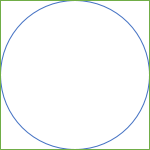

*A014 · 图 1 / Figure 1 · [图片来源 / Image source](https://blog.ploeh.dk/content/binary/circle-with-bounding-box.png)*

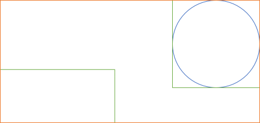

*A014 · 图 2 / Figure 2 · [图片来源 / Image source](https://blog.ploeh.dk/content/binary/union-of-bounding-boxes.png)*

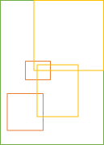

*A014 · 图 3 / Figure 3 · [图片来源 / Image source](https://blog.ploeh.dk/content/binary/bounding-box-with-identity-candidates.png)*

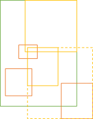

*A014 · 图 4 / Figure 4 · [图片来源 / Image source](https://blog.ploeh.dk/content/binary/bounding-box-identity-counter-example.png)*

[返回目录 / Back to catalogue](#catalogue)

---

<a id="a015"></a>

###### A015 · 半群的累积

*Semigroups accumulate*

[原文 / Source](https://blog.ploeh.dk/2017/12/11/semigroups-accumulate/) · 发布日期 / Published: 2017/12/11

**中文导读**

没有单位元时，非空集合仍可归约：把头元素作为起点，再处理尾部。让 NonEmpty 类型保证至少一个元素，可把“不支持空输入”的约束从运行时错误变成数据结构的不变量。

**English**

A nonempty collection supplies its own accumulation seed. Separating the head from the tail expresses the requirement directly in the type, avoiding an invented default value or a failure that appears only when reduction begins.

**思考 / Study question**

非空类型怎样帮助 API 设计？ / How does a nonempty type improve an API?

[返回目录 / Back to catalogue](#catalogue)

---

<a id="a016"></a>

##### A016 · 拟群

*Quasigroups*

[原文 / Source](https://blog.ploeh.dk/2017/12/18/quasigroups/) · 发布日期 / Published: 2017/12/18

**中文导读**

拟群要求左右方程都具有唯一解，不要求结合律或单位元。整数减法是直观例子：能反求未知操作数，却不能随意重分组。整数加法也满足拟群要求，并额外具有其他法则；这些分类不全是互斥关系。

**English**

Quasigroups require unique solutions to equations on either side of the operation. Subtraction illustrates this without associativity. Additional laws are allowed, so an operation can belong to several structures rather than occupying one exclusive category.

**思考 / Study question**

可反求输入为何不代表可重分组？ / Why does invertibility not imply associativity?

[返回目录 / Back to catalogue](#catalogue)

---

<a id="a017"></a>

##### A017 · 原群（Magma）

*Magmas*

[原文 / Source](https://blog.ploeh.dk/2017/12/27/magmas/) · 发布日期 / Published: 2017/12/27

**中文导读**

Magma 只要求同一载体上的封闭二元运算，不附加结合性等法则。它是识别组合操作的最低层描述。拿到一个 API 后，先确认它是 Magma，再分别检查法则，比看到 Add 或 Combine 就宣称幺半群更可靠。

**English**

A magma supplies a closed binary operation without further algebraic promises. It provides a starting vocabulary for combinations whose behavior must be investigated. Method names alone cannot establish the stronger guarantees of semigroups or monoids.

**思考 / Study question**

一个 Combine 方法究竟保证了什么？ / What does a Combine method actually guarantee?

**原文配图 / Original illustrations**


*A017 · 图 1 / Figure 1 · [图片来源 / Image source](https://blog.ploeh.dk/content/binary/magmas-quasigroups-semigroups-monoids.png)*

[返回目录 / Back to catalogue](#catalogue)

---

<a id="a018"></a>

###### A018 · 石头剪刀布原群

*Rock Paper Scissors magma*

[原文 / Source](https://blog.ploeh.dk/2017/12/28/rock-paper-scissors-magma/) · 发布日期 / Published: 2017/12/28

**中文导读**

把两次出拳合成为胜出的手势，平局保留该手势，可以得到封闭运算。这个规则可交换，却不满足结合律，也没有单位元。它展示了一个容易误判的事实：对调操作数不影响结果，并不意味着分组也无关。

**English**

Selecting the winning gesture defines a closed combination. Symmetry between contestants makes it commutative, yet regrouping three gestures can change the outcome. The example separates commutativity from associativity with a small, inspectable domain.

**思考 / Study question**

请找一个结合律反例。 / Can you find an associativity counterexample?

[返回目录 / Back to catalogue](#catalogue)

---

<a id="a019"></a>

###### A019 · 颜色混合原群

*Colour-mixing magma*

[原文 / Source](https://blog.ploeh.dk/2018/01/02/colour-mixing-magma/) · 发布日期 / Published: 2018/01/02

**中文导读**

文章按 RGB 分量平均来混色，结果仍是颜色，且交换两种颜色不变。但重复平均会给不同颜色不同权重，导致结合律失效；每步的整数取整还可能影响结果。这种 Mix 不适合直接当作可任意分组的归约。

**English**

Component-wise color averaging is closed and symmetric, but nested averages assign unequal weights. Regrouping therefore changes the result. A plausible-looking combination operation can lack precisely the law needed for predictable multi-value accumulation.

**思考 / Study question**

要分组无关，需额外保存哪些信息？ / What extra information would make grouping independent?

[返回目录 / Back to catalogue](#catalogue)

---

### 第二部分：函子与计算组合 / Part II: Functors and computation

<a id="a020"></a>

#### A020 · 函子、应用函子及相关结构

*Functors, applicatives, and friends*

[原文 / Source](https://blog.ploeh.dk/2018/03/19/functors-applicatives-and-friends/) · 发布日期 / Published: 2018/03/19

**中文导读**

这一支把“映射结构中的值”作为起点，依次研究独立组合、多个类型参数、输入方向的映射、计算串联和嵌套容器。泛型类型并不自动成为函子；Select 等方法还应满足法则。容器是教学比喻，函数也是重要例子。

**English**

This branch develops mapping, independent combination, variance, sequencing, and relationships between structures. Generic syntax alone proves little. Function examples also show why the container metaphor is useful for intuition but narrower than the abstraction itself.

**思考 / Study question**

函数怎样也能被看成函子？ / How can functions form a functor?

**原文配图 / Original illustrations**

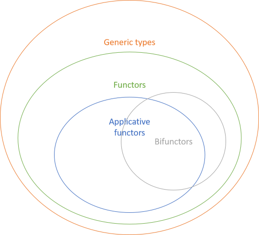

*A020 · 图 1 / Figure 1 · [图片来源 / Image source](https://blog.ploeh.dk/content/binary/functors-applicatives-bifunctors.png)*

[返回目录 / Back to catalogue](#catalogue)

---

<a id="a021"></a>

##### A021 · 函子

*Functors*

[原文 / Source](https://blog.ploeh.dk/2018/03/22/functors/) · 发布日期 / Published: 2018/03/22

**中文导读**

给定 A→B，map 将 F<A> 转为 F<B>，遵守恒等与复合法则。列表的 Select 是熟悉入口，但树、可选值和异步计算也有映射。这里的“保持结构”需结合各类型理解，并不等于永远保留元素数量。

**English**

Mapping changes the value parameter while respecting identity and composition. Familiar LINQ projection supplies an entry point, but the idea also covers optional values, trees, and computations. What remains invariant depends on the particular structure being modeled.

**思考 / Study question**

map 与普通转换函数有什么区别？ / What distinguishes map from an arbitrary conversion?

**原文配图 / Original illustrations**

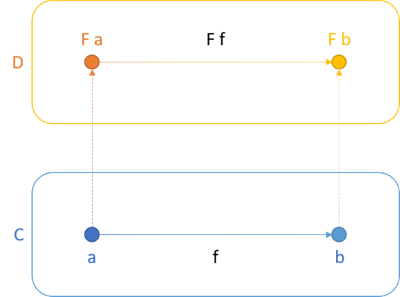

*A021 · 图 1 / Figure 1 · [图片来源 / Image source](https://blog.ploeh.dk/content/binary/functor-diagram.png)*

[返回目录 / Back to catalogue](#catalogue)

---

<a id="a022"></a>

###### A022 · Maybe 函子

*The Maybe functor*

[原文 / Source](https://blog.ploeh.dk/2018/03/26/the-maybe-functor/) · 发布日期 / Published: 2018/03/26

**中文导读**

Maybe 把缺失显式编码为 Nothing，把存在编码为 Just 值。map 只改变存在的值，缺失仍然缺失，因此调用者无需把空值分支散布到每一步。文章通过 C#、F#、Haskell 对照展示同一抽象。

**English**

Mapping an optional value applies a function only to the present case. Absence propagates unchanged. This moves repetitive missing-value handling into the abstraction while retaining a clear distinction between a value and the lack of one.

**思考 / Study question**

map 能把 Nothing 变成 Just 吗？ / Can lawful mapping turn Nothing into Just?

[返回目录 / Back to catalogue](#catalogue)

---

<a id="a023"></a>

###### A023 · Either 的单参数函子视角

*An Either functor*

[原文 / Source](https://blog.ploeh.dk/2019/01/14/an-either-functor/) · 发布日期 / Published: 2019/01/14

**中文导读**

固定错误类型，只映射成功的一侧，就得到 Either 的常用函子视角。失败仍携带原错误，成功值可以换成另一个类型；C# 的 Select 还能启用查询语法。映射左侧与右侧，是后续双函子章节要区分的能力。

**English**

Fixing the error parameter makes Either useful as a one-parameter functor over successes. Projection preserves failures while transforming successful values. Its query syntax adapter exposes existing right-side mapping through the conventions expected by C#.

**思考 / Study question**

错误分支为什么保持不变？ / Why does the error branch remain unchanged?

[返回目录 / Back to catalogue](#catalogue)

---

<a id="a024"></a>

###### A024 · 树函子

*A Tree functor*

[原文 / Source](https://blog.ploeh.dk/2018/08/06/a-tree-functor/) · 发布日期 / Published: 2018/08/06

**中文导读**

对每个节点的值递归应用映射，而保留父子关系与树形结构，就可把 Tree<A> 转为 Tree<B>。文章对比不同语言的实现长度，强调抽象相同、语言支持不同。删除节点或重新安排子树是另一类操作。

**English**

Tree mapping visits node values recursively while retaining the branching arrangement. The same abstraction can require very different amounts of code across languages. Changes to topology require operations beyond this particular mapping contract.

**思考 / Study question**

树的 map 会重新组织分支吗？ / Does tree mapping reorganize branches?

[返回目录 / Back to catalogue](#catalogue)

---

<a id="a025"></a>

###### A025 · 玫瑰树的函子视角

*A rose tree functor*

[原文 / Source](https://blog.ploeh.dk/2019/08/19/a-rose-tree-functor/) · 发布日期 / Published: 2019/08/19

**中文导读**

这里的玫瑰树区分内部节点与叶子的类型。固定内部节点类型，仅映射叶子，即得普通函子；这从双函子的一个维度派生而来。文章用菜单示例展示 Select，而非声称它增加了超出 SelectLeaf 的能力。

**English**

This rose-tree representation distinguishes internal labels from leaf values. Holding one parameter fixed produces a conventional functor over leaves. The menu example connects that view to query syntax without adding a new underlying transformation.

**思考 / Study question**

固定哪个参数会得到哪一种函子？ / Which parameter is fixed in this functor view?

[返回目录 / Back to catalogue](#catalogue)

---

<a id="a026"></a>

###### A026 · Visitor 函子

*A Visitor functor*

[原文 / Source](https://blog.ploeh.dk/2018/08/13/a-visitor-functor/) · 发布日期 / Published: 2018/08/13

**中文导读**

并非每个 Visitor 都是函子。文章中的泛型 Visitor 表示互斥的数据分支，并能一致映射其中的值；于是可验证函子法则。Visitor 是对象语言表示和类型的一条路线，但其样板代码通常多于函数式语言中的声明。

**English**

A suitably parameterized Visitor can encode mutually exclusive cases and support lawful mapping. The claim concerns this structure, rather than every use of the pattern. It also illustrates the cost of expressing algebraic alternatives through object-oriented interfaces.

**思考 / Study question**

怎样判断某个 Visitor 是否可映射？ / How would you identify a mappable Visitor?

[返回目录 / Back to catalogue](#catalogue)

---

<a id="a027"></a>

###### A027 · 响应式函子

*Reactive functor*

[原文 / Source](https://blog.ploeh.dk/2018/08/20/reactive-functor/) · 发布日期 / Published: 2018/08/20

**中文导读**

IObservable<T> 可以对流中的值做 Select，从而改变值的类型，继续保留响应式计算的框架。文章借实例测试展示两条函子法则；有限测试并不是全称证明。流的时间、错误、订阅与副作用语义仍需在实际 Rx 使用中说明。

**English**

Observable projection demonstrates the same mapping vocabulary in a reactive library. Example tests illustrate the laws rather than proving every case. Real streams additionally carry subscription, timing, failure, and execution semantics that a value-only explanation does not settle.

**思考 / Study question**

观察流相等时要比较哪些方面？ / What should observable equality take into account?

[返回目录 / Back to catalogue](#catalogue)

---

<a id="a028"></a>

###### A028 · Identity 函子

*The Identity functor*

[原文 / Source](https://blog.ploeh.dk/2018/09/03/the-identity-functor/) · 发布日期 / Published: 2018/09/03

**中文导读**

Identity 只包住一个值，map 则包住映射结果。它没有失败、分支或延迟等额外行为，因此适合看清函子的最小骨架。它在可对任意函子编程的抽象代码中有意义，但作者未给出 C# 或 F# 中的直接实用案例。

**English**

A wrapper with no additional computational behavior exposes the bare mapping mechanism. It is useful for understanding generic abstractions, especially where the type system can quantify over functors. The article distinguishes that role from everyday application needs.

**思考 / Study question**

没有额外行为为何仍需要一个类型？ / Why represent a computation with no extra behavior?

[返回目录 / Back to catalogue](#catalogue)

---

<a id="a029"></a>

###### A029 · Lazy 函子

*The Lazy functor*

[原文 / Source](https://blog.ploeh.dk/2018/09/10/the-lazy-functor/) · 发布日期 / Published: 2018/09/10

**中文导读**

对延迟计算做 map，得到另一个延迟计算，只有取值时才应用转换。这样可逐步搭建表达式而不立即执行。C# Lazy 的缓存和状态变化，与 Haskell 默认非严格求值并不是完全相同的机制。

**English**

Projection over a deferred computation builds another deferred computation. This supports incremental construction without immediate evaluation. The article separates that general idea from the particular caching behavior of .NET Lazy and Haskell's evaluation model.

**思考 / Study question**

map 应改变求值时机吗？ / Should mapping change when evaluation occurs?

[返回目录 / Back to catalogue](#catalogue)

---

<a id="a030"></a>

###### A030 · 异步函子

*Asynchronous functors*

[原文 / Source](https://blog.ploeh.dk/2018/09/24/asynchronous-functors/) · 发布日期 / Published: 2018/09/24

**中文导读**

对 Task<T> 或 Async<T> 映射，在结果可用后转换其值，得到相同异步形式的新结果。文章展示两种表示的转换，也承认性能差异。把它们视作相同抽象，不表示启动时机、取消或调度细节完全一致。

**English**

Asynchronous projection transforms the eventual result while staying within an asynchronous representation. Task and F# Async illustrate a shared abstraction with different operational characteristics. Representation conversions should therefore be assessed alongside execution and performance behavior.

**思考 / Study question**

异步 map 与 await 后转换有何联系？ / How does asynchronous map relate to transforming an awaited result?

**原文配图 / Original illustrations**

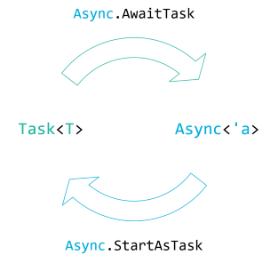

*A030 · 图 1 / Figure 1 · [图片来源 / Image source](https://blog.ploeh.dk/content/binary/equivalence-of-task-and-async.png)*

[返回目录 / Back to catalogue](#catalogue)

---

<a id="a031"></a>

###### A031 · Const 函子

*The Const functor*

[原文 / Source](https://blog.ploeh.dk/2024/10/07/the-const-functor/) · 发布日期 / Published: 2024/10/07

**中文导读**

Const<C,A> 保存 C，A 只是类型位置；map 不使用传入的 A→B，而保留同一个 C。看似无事可做，却满足函子法则。它使固定数据也能参与由函子积、和、复合构成的较大类型，需与 Identity 区分。

**English**

Const retains stored data while changing a phantom type parameter. Its mapping ignores the supplied transformation. This apparently trivial construction lets fixed information participate in larger functor structures, unlike Identity, which actually stores and transforms the mapped value.

**思考 / Study question**

Const 与 Identity 分别存了什么？ / What do Const and Identity actually store?

[返回目录 / Back to catalogue](#catalogue)

---

<a id="a032"></a>

###### A032 · State 函子

*The State functor*

[原文 / Source](https://blog.ploeh.dk/2021/07/19/the-state-functor/) · 发布日期 / Published: 2021/07/19

**中文导读**

State<S,A> 可理解为 S→(A,S)。映射只改变产生的 A，不改写本次计算返回的状态 S。这把显式状态输入输出与普通结果变换分开；后续 State Monad 才进一步负责多个步骤之间的状态传递。

**English**

A state computation returns a result together with a state. Mapping changes the result component and preserves the returned state. This isolates value transformation from the separate problem of threading state through successive computations.

**思考 / Study question**

map 为什么不应该改变状态分量？ / Why should map leave the state component intact?

[返回目录 / Back to catalogue](#catalogue)

---

<a id="a033"></a>

###### A033 · Reader 函子

*The Reader functor*

[原文 / Source](https://blog.ploeh.dk/2021/08/30/the-reader-functor/) · 发布日期 / Published: 2021/08/30

**中文导读**

固定输入或环境 R，Reader<R,A> 就是 R→A。map 在原函数之后接一个 A→B，得到 R→B。因此函数也有函子结构，并不必须把值装在物理容器中；文章更重视这一分析视角，而非包装接口的必要性。

**English**

With its input fixed, a function supports mapping by postcomposition. The result remains a function of the same environment. Reader thus broadens the usual container intuition and provides an analytical perspective even when no explicit wrapper is needed.

**思考 / Study question**

Reader 的 map 是前置还是后置组合？ / Does Reader map compose before or after the original function?

[返回目录 / Back to catalogue](#catalogue)

---

<a id="a034"></a>

###### A034 · IO 函子

*The IO functor*

[原文 / Source](https://blog.ploeh.dk/2020/06/22/the-io-functor/) · 发布日期 / Published: 2020/06/22

**中文导读**

IO 的映射改变动作产生的结果，而继续留在 IO 表示中。文章在 C# 中用延迟函数包装示意，并由 Bind 推出 Select。此模型帮助理解 API 形状，但 C# 的类型系统不会像 Haskell 一样强制隔离副作用。

**English**

IO projection changes an action's result without leaving the action representation. The C# sketch makes the API shape visible through a deferred function wrapper. It supplies intuition, while lacking the language-enforced effect boundaries provided by Haskell.

**思考 / Study question**

包装 IO 是否自动让 C# 代码纯化？ / Does an IO wrapper automatically make C# code pure?

[返回目录 / Back to catalogue](#catalogue)

---

<a id="a035"></a>

###### A035 · 单态函子

*Monomorphic functors*

[原文 / Source](https://blog.ploeh.dk/2020/10/19/monomorphic-functors/) · 发布日期 / Published: 2020/10/19

**中文导读**

有些可映射结构不允许任意改变元素类型，例如字符串中的字符映射或固定领域对象内部的映射。文章称之为单态函子，并展示餐厅数据的例子。它说明 map 思路可用于非泛型 API，但不要与完整参数多态接口混为一谈。

**English**

Some structures support only type-restricted mapping, such as character transformations within strings. The article extends the mapping perspective to immutable domain data. These operations are useful, but expose less polymorphism than a fully generic functor interface.

**思考 / Study question**

只能 char→char 的映射限制了什么？ / What is lost when mapping is restricted to char-to-char functions?

[返回目录 / Back to catalogue](#catalogue)

---

<a id="a036"></a>

###### A036 · Set 不是函子？——须结合勘误阅读

*Set is not a functor*

[原文 / Source](https://blog.ploeh.dk/2018/12/03/set-is-not-a-functor/) · 发布日期 / Published: 2018/12/03

**中文导读**

正文以 HashSet 与 DateTimeOffset 的去重示例质疑复合法则。2019 年补记承认：若相等必须具有可替换性，这个反例只能说明该相等实现有问题，不能推出集合不是函子。本篇应作为“映射必须尊重相等”的案例阅读。

**English**

The original counterexample combines deduplication with DateTimeOffset equality. The author's later postscript acknowledges that an equality-substitution requirement undermines the broad conclusion. Read this as a warning about representation and equality, rather than a proof against mathematical set mapping.

**思考 / Study question**

转换函数是否尊重所选的相等关系？ / Does the transformation respect the chosen equality relation?

**原文配图 / Original illustrations**

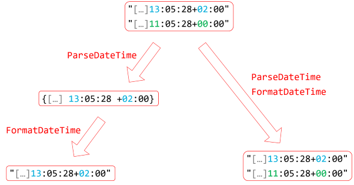

*A036 · 图 1 / Figure 1 · [图片来源 / Image source](https://blog.ploeh.dk/content/binary/set-violating-second-functor-law.png)*

[返回目录 / Back to catalogue](#catalogue)

---

<a id="a037"></a>

##### A037 · 应用函子

*Applicative functors*

[原文 / Source](https://blog.ploeh.dk/2018/10/01/applicative-functors/) · 发布日期 / Published: 2018/10/01

**中文导读**

Applicative 让多个结构中的值参与一次组合，典型 API 是 pure 与 apply。与 Monad 相比，后一个计算不必由前一个的值来选择；但独立的计算结构不保证并行执行，顺序与效果仍取决于具体实例。

**English**

Applicative operations combine values whose computational structure can be established independently. A wrapped function can be applied to wrapped arguments. This is weaker than result-dependent sequencing, and should not be confused with an automatic promise of parallel execution.

**思考 / Study question**

独立组合与依赖串联怎样区分？ / How does independent combination differ from dependent sequencing?

[返回目录 / Back to catalogue](#catalogue)

---

<a id="a038"></a>

###### A038 · 完整的一副牌

*Full deck*

[原文 / Source](https://blog.ploeh.dk/2018/10/08/full-deck/) · 发布日期 / Published: 2018/10/08

**中文导读**

花色集合与牌面集合通过列表 Applicative 形成所有组合。构造一张牌的函数被应用于两个列表，得到笛卡尔积式结果。文章以 Haskell 与 F# 展示此思路，重点是组合规则，不是手写两重循环的语法。

**English**

A deck arises by combining every suit with every face. The list applicative expresses this Cartesian-product behavior directly. The example provides a concrete interpretation of applying a multi-argument constructor across independent collections of alternatives.

**思考 / Study question**

这里是逐项配对还是所有组合？ / Is this pairwise zipping or every possible combination?

[返回目录 / Back to catalogue](#catalogue)

---

<a id="a039"></a>

###### A039 · 应用式密码列表

*An applicative password list*

[原文 / Source](https://blog.ploeh.dk/2018/10/15/an-applicative-password-list/) · 发布日期 / Published: 2018/10/15

**中文导读**

文章从基础字符串的不同变形构造候选列表，展示列表 Applicative 如何展开多种独立选择，并翻译到 C#。阅读时关注“组合空间”与 API 形式即可：结果数量会随各维选择数相乘，物化所有候选并不总是合适。

**English**

Alternative string fragments generate a space of candidate combinations. The example translates applicative list operations into C# and reveals some language friction. Its reusable lesson is how independent choices expand into a potentially large Cartesian product.

**思考 / Study question**

三组选择的结果数如何计算？ / How many results arise from three independent choice sets?

[返回目录 / Back to catalogue](#catalogue)

---

<a id="a040"></a>

###### A040 · 函数的应用式组合

*Applicative combinations of functions*

[原文 / Source](https://blog.ploeh.dk/2018/10/22/applicative-combinations-of-functions/) · 发布日期 / Published: 2018/10/22

**中文导读**

列表里既可放普通值，也可放函数。将多个转换函数应用于多个输入，可一次表达各种函数与值的组合；再组合多参数函数，还能构造更丰富的结果。这里不应把 apply 误读为单纯遍历值的 map。

**English**

Lists can hold transformations as well as data. Applicative application combines each available function with the available arguments, making functions participants in the same alternative-generating structure. This extends ordinary projection to combinations across multiple wrapped inputs.

**思考 / Study question**

函数列表与值列表分别贡献什么？ / What do function and value lists each contribute?

[返回目录 / Back to catalogue](#catalogue)

---

<a id="a041"></a>

###### A041 · Maybe 应用函子

*The Maybe applicative functor*

[原文 / Source](https://blog.ploeh.dk/2018/10/29/the-maybe-applicative-functor/) · 发布日期 / Published: 2018/10/29

**中文导读**

多个可选输入都存在时，应用其组合函数；任意一个缺失，结果便缺失。它把许多局部存在性检查集中到结构中。文章也展示 C# 查询写法，但那借用了 Maybe 的 Monad 能力，不能据此说所有 Applicative 都支持该写法。

**English**

Optional application succeeds only when all required inputs are present. Missing inputs propagate through the combination. The article also uses monadic query syntax, which is available for Maybe but cannot be assumed for every applicative structure.

**思考 / Study question**

为什么某些 Applicative 不能使用 SelectMany？ / Why might an applicative lack SelectMany?

[返回目录 / Back to catalogue](#catalogue)

---

<a id="a042"></a>

###### A042 · 应用式验证

*Applicative validation*

[原文 / Source](https://blog.ploeh.dk/2018/11/05/applicative-validation/) · 发布日期 / Published: 2018/11/05

**中文导读**

日期、数量、邮箱可先各自验证，再组合成完整结果。若希望一次报告所有错误，必须选择可累积错误的 Applicative，并为错误定义合并规则。标准 Either 的失败短路语义不同，不能仅凭 Result 名称判断行为。

**English**

Independent validations can be assembled into one result. Collecting multiple failures requires an accumulating applicative with a suitable error combination operation. A conventional short-circuiting Either instance follows different rules, despite having a superficially similar result type.

**思考 / Study question**

怎样同时返回两个字段的错误？ / How can two field errors be returned together?

[返回目录 / Back to catalogue](#catalogue)

---

<a id="a043"></a>

###### A043 · 测试数据生成器应用函子

*The Test Data Generator applicative functor*

[原文 / Source](https://blog.ploeh.dk/2018/11/26/the-test-data-generator-applicative-functor/) · 发布日期 / Published: 2018/11/26

**中文导读**

将简单随机生成器组合为复杂数据生成器，可保持构造过程模块化。Applicative 适用于可预先确定结构的生成步骤；文章以个人编号示例及 Hedgehog 对照展示。关注生成器如何传递随机状态，而不仅看最终随机值。

**English**

Small generators can be combined into generators of richer objects. Applicative composition fits a construction whose components are specified independently. Comparing C# and Hedgehog examples helps separate the shared abstraction from each library's random-state and API mechanics.

**思考 / Study question**

组合生成器需要共享哪类执行信息？ / What execution information must combined generators carry?

[返回目录 / Back to catalogue](#catalogue)

---

<a id="a044"></a>

###### A044 · F# 中的丹麦个人编号

*Danish CPR numbers in F#*

[原文 / Source](https://blog.ploeh.dk/2018/12/10/danish-cpr-numbers-in-f/) · 发布日期 / Published: 2018/12/10

**中文导读**

这是领域建模示例：利用受控构造保护值的有效性，再用 option 的应用式组合把多个已解析部分拼成编号。任何一部分失败，整体失败。文中编号规则应作为历史教学背景，不能据此推断当前行政制度。

**English**

The case study combines encapsulated domain construction with optional parsing. Applicative option composition assembles valid components only when each required part succeeds. Its value here is the modeling technique, rather than an authoritative specification of contemporary identification rules.

**思考 / Study question**

如何阻止不合法值绕过构造入口？ / How can invalid values be kept outside the domain constructor?

[返回目录 / Back to catalogue](#catalogue)

---

<a id="a045"></a>

###### A045 · Lazy 应用函子

*The Lazy applicative functor*

[原文 / Source](https://blog.ploeh.dk/2018/12/17/the-lazy-applicative-functor/) · 发布日期 / Published: 2018/12/17

**中文导读**

多个延迟计算可组合成一个延迟结果，组合阶段无需取得所有值。apply 可把延迟的函数应用到延迟的参数上。与 Lazy 的 map 相比，此时可协调多个包装值；实际执行与缓存策略仍由具体 Lazy 实现决定。

**English**

Applicative Lazy combines deferred arguments with deferred transformations. The resulting computation remains deferred until demanded. This extends single-value projection to multi-input construction while leaving execution and caching policy to the underlying lazy representation.

**思考 / Study question**

map 与 apply 在这里分别处理几个包装值？ / How many wrapped inputs do map and apply handle here?

[返回目录 / Back to catalogue](#catalogue)

---

<a id="a046"></a>

###### A046 · 应用函子中的幺半群——推广猜想

*Applicative monoids*

[原文 / Source](https://blog.ploeh.dk/2019/04/22/applicative-monoids/) · 发布日期 / Published: 2019/04/22

**中文导读**

文章尝试把底层幺半群运算提升到 Applicative，使用 pure 包装单位元，并用 Monap 示例研究法则。作者在结尾以猜想描述推广结果。应对具体实例检查效果及法则，不把列表笛卡尔积、失败、延迟等语义自动视作完全等价。

**English**

The article explores lifting a monoidal operation into an applicative wrapper. Its conclusion explicitly presents the generalization as a conjecture. For a concrete instance, examine the lifted operation's laws and effects instead of assuming that every wrapper preserves identical behavior.

**思考 / Study question**

提升之后的单位元与结合律如何验证？ / How should identity and associativity be checked after lifting?

[返回目录 / Back to catalogue](#catalogue)

---

<a id="a047"></a>

##### A047 · 双函子

*Bifunctors*

[原文 / Source](https://blog.ploeh.dk/2018/12/24/bifunctors/) · 发布日期 / Published: 2018/12/24

**中文导读**

双函子允许独立映射两个类型参数，并要求联合映射与分侧映射一致。元组和 Either 都是典型例子，但前者同时含两个值，后者只含一个分支。理解“两个维度”比把它当成“包含两个值”更准确。

**English**

Bifunctors support transformations in two type parameters. Their joint and separate mappings must agree. Pairs and alternatives share these laws despite storing different amounts of data: one holds both components, while the other selects a single case.

**思考 / Study question**

两个类型参数是否意味着两个现存值？ / Do two type parameters imply two stored values?

**原文配图 / Original illustrations**

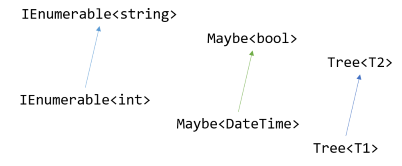

*A047 · 图 1 / Figure 1 · [图片来源 / Image source](https://blog.ploeh.dk/content/binary/monofunctors.png)*

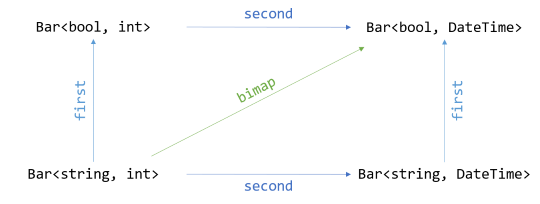

*A047 · 图 2 / Figure 2 · [图片来源 / Image source](https://blog.ploeh.dk/content/binary/bifunctor.png)*

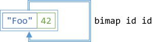

*A047 · 图 3 / Figure 3 · [图片来源 / Image source](https://blog.ploeh.dk/content/binary/bimap-id-id-bifunctor-law.png)*

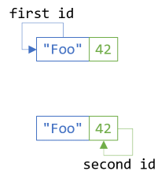

*A047 · 图 4 / Figure 4 · [图片来源 / Image source](https://blog.ploeh.dk/content/binary/first-id-second-id-bifunctor-laws.png)*

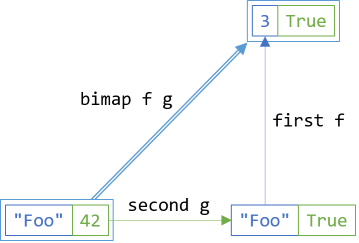

*A047 · 图 5 / Figure 5 · [图片来源 / Image source](https://blog.ploeh.dk/content/binary/bifunctor-consistency-law.png)*

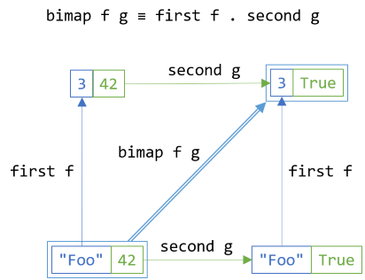

*A047 · 图 6 / Figure 6 · [图片来源 / Image source](https://blog.ploeh.dk/content/binary/bifunctor-consistency-commutativity-law.png)*

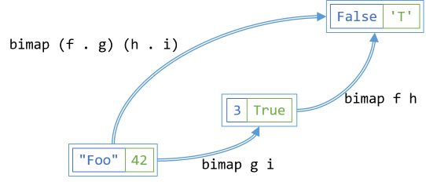

*A047 · 图 7 / Figure 7 · [图片来源 / Image source](https://blog.ploeh.dk/content/binary/bimap-composition-law.png)*

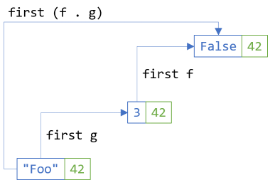

*A047 · 图 8 / Figure 8 · [图片来源 / Image source](https://blog.ploeh.dk/content/binary/second-functor-law-over-first-bifunctor-dimension.png)*

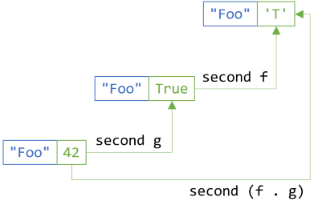

*A047 · 图 9 / Figure 9 · [图片来源 / Image source](https://blog.ploeh.dk/content/binary/second-functor-law-over-second-bifunctor-dimension.png)*

[返回目录 / Back to catalogue](#catalogue)

---

<a id="a048"></a>

###### A048 · 元组双函子

*Tuple bifunctor*

[原文 / Source](https://blog.ploeh.dk/2018/12/31/tuple-bifunctor/) · 发布日期 / Published: 2018/12/31

**中文导读**

对 Pair<A,B> 的左右分量分别映射，可得到 Pair<C,D>；也可只改变一侧。联合映射要与先左后右等价，并满足相应恒等与复合法则。元组结构始终是两个位置同时存在，这与 Either 的择一结构不同。

**English**

A pair maps each component with its corresponding function. Separate transformations and a joint transformation agree, and neither removes a component. The example makes the product interpretation of two independent type positions particularly easy to inspect.

**思考 / Study question**

左映射与右映射的执行次序影响结果吗？ / Does the order of left and right mappings affect the result?

[返回目录 / Back to catalogue](#catalogue)

---

<a id="a049"></a>

###### A049 · Either 双函子

*Either bifunctor*

[原文 / Source](https://blog.ploeh.dk/2019/01/07/either-bifunctor/) · 发布日期 / Published: 2019/01/07

**中文导读**

Either<A,B> 可分别转换错误与成功类型，但实际只应用当前分支对应的函数。Left 保持 Left，Right 保持 Right。固定左参数后，只映射右侧，就回到常用的单参数函子；改变分支则不是这里的 bimap。

**English**

Either exposes two mapping dimensions while containing only one active case. Each transformation preserves which alternative is present. Fixing one parameter recovers the familiar one-sided functor view, connecting error mapping and success mapping within a shared structure.

**思考 / Study question**

bimap 会把 Left 变成 Right 吗？ / Can bimap change Left into Right?

[返回目录 / Back to catalogue](#catalogue)

---

<a id="a050"></a>

###### A050 · 玫瑰树双函子

*Rose tree bifunctor*

[原文 / Source](https://blog.ploeh.dk/2019/08/12/rose-tree-bifunctor/) · 发布日期 / Published: 2019/08/12

**中文导读**

文章的玫瑰树用不同类型表示内部节点与叶子，因此 bimap 接受两种转换，递归作用于各自位置。树形、节点和叶子的数量保持不变。这里“玫瑰树”是作者选用的具体双参数模型，不是所有同名树的唯一表示。

**English**

Distinct internal-node labels and leaf values provide two mapping dimensions. A recursive bimap transforms each category while retaining topology. The discussion concerns this particular representation; the name rose tree does not universally require the same two-parameter design.

**思考 / Study question**

内部节点与叶子为何可能需要不同类型？ / Why might nodes and leaves need different types?

[返回目录 / Back to catalogue](#catalogue)

---

<a id="a051"></a>

##### A051 · 逆变函子

*Contravariant functors*

[原文 / Source](https://blog.ploeh.dk/2021/09/02/contravariant-functors/) · 发布日期 / Published: 2021/09/02

**中文导读**

给定 B→A，逆变映射可把消费 A 的结构改造成消费 B 的结构：先转换输入，再交给原操作。方向与普通 map 相反，但同样受恒等与复合约束。命令处理器、谓词和比较器是具体入口。

**English**

Contravariant mapping adapts consumers by transforming their inputs first. A function from a new input type to the old one yields a consumer of the new type. Handlers, predicates, and comparisons make this reversed mapping direction concrete.

**思考 / Study question**

为什么需要 B→A 而不是 A→B？ / Why is the adaptation function directed from B to A?

**原文配图 / Original illustrations**


*A051 · 图 1 / Figure 1 · [图片来源 / Image source](https://blog.ploeh.dk/content/binary/functor-diagram.png)*

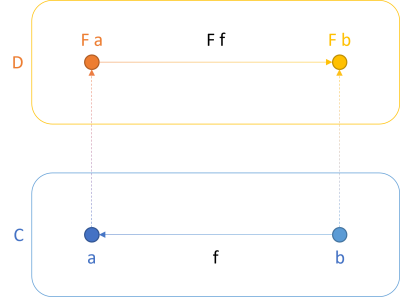

*A051 · 图 2 / Figure 2 · [图片来源 / Image source](https://blog.ploeh.dk/content/binary/contravariant-functor-diagram.png)*

[返回目录 / Back to catalogue](#catalogue)

---

<a id="a052"></a>

###### A052 · 命令处理器逆变函子

*The Command Handler contravariant functor*

[原文 / Source](https://blog.ploeh.dk/2021/09/06/the-command-handler-contravariant-functor/) · 发布日期 / Published: 2021/09/06

**中文导读**

已有处理 A 命令的 Handler，若能把 B 转成 A，就可构造处理 B 的 Handler。转换负责输入适配，处理器保留原处理职责。文章进一步连接领域建模与 Action<T>，但不主张必须为了这个视角添加大量包装代码。

**English**

A command handler can be adapted through an input conversion. The resulting handler accepts a new command shape while delegating the actual handling to the original implementation. This also explains the contravariant perspective on ordinary actions and event consumers.

**思考 / Study question**

适配函数应承担哪些职责？ / Which responsibilities belong in the input adapter?

[返回目录 / Back to catalogue](#catalogue)

---

<a id="a053"></a>

###### A053 · Specification 逆变函子

*The Specification contravariant functor*

[原文 / Source](https://blog.ploeh.dk/2021/09/09/the-specification-contravariant-functor/) · 发布日期 / Published: 2021/09/09

**中文导读**

一个 A→bool 的规则可通过 B→A 投影复用于 B，例如先从产品取得库存数，再应用数量规则。Specification、Predicate<T> 与 Func<T,bool> 都体现这种结构。逆变组合的价值是复用已有判定，避免复制领域规则。

**English**

A predicate on one type can be reused by projecting a richer input into that type. Specifications and ordinary Boolean-valued functions share this mechanism. The construction localizes the original rule and moves only the input adaptation into a new layer.

**思考 / Study question**

怎样把数量规则复用于产品对象？ / How can a quantity rule be reused for product objects?

[返回目录 / Back to catalogue](#catalogue)

---

<a id="a054"></a>

###### A054 · 等价关系逆变函子

*The Equivalence contravariant functor*

[原文 / Source](https://blog.ploeh.dk/2021/09/27/the-equivalence-contravariant-functor/) · 发布日期 / Published: 2021/09/27

**中文导读**

比较两个 B 时，先把两者都投影成 A，再使用 A 的比较器，可得到 B 的比较方式。文章用放宽测试比较说明其用途。在 .NET 中还需让哈希与相等一致；GetHashCode 是实现要求，不是数学等价关系的定义。

**English**

An equality comparison can be adapted by projecting both inputs through the same function. This supports focused comparisons without duplicating rules. A .NET comparer must additionally coordinate its hash behavior with equality, even though hashing is outside the mathematical relation itself.

**思考 / Study question**

只比较部分字段会改变什么相等语义？ / How does comparing selected fields change equality semantics?

[返回目录 / Back to catalogue](#catalogue)

---

<a id="a055"></a>

###### A055 · Reader 的逆变视角

*Reader as a contravariant functor*

[原文 / Source](https://blog.ploeh.dk/2021/10/04/reader-as-a-contravariant-functor/) · 发布日期 / Published: 2021/10/04

**中文导读**

固定函数的输出，映射其输入：先运行 B→A，再执行 A→R，得到 B→R。上一 Reader 函子篇映射输出，本篇映射输入。两者落在同一函数的不同位置，为后续 Profunctor 的双向视角做准备。

**English**

Fixing a function's result exposes contravariant behavior in its input. Precomposition supplies the adaptation. Together with Reader's covariant result mapping, this gives two complementary views of a single ordinary function and prepares the profunctor construction.

**思考 / Study question**

Reader 的两个视角分别固定哪个参数？ / Which parameter is fixed in each Reader view?

[返回目录 / Back to catalogue](#catalogue)

---

<a id="a056"></a>

###### A056 · 函子变型与 C# 变型

*Functor variance compared to C#'s notion of variance*

[原文 / Source](https://blog.ploeh.dk/2021/10/25/functor-variance-compared-to-cs-notion-of-variance/) · 发布日期 / Published: 2021/10/25

**中文导读**

C# 的 in/out 处理继承关系下的赋值兼容，转换通常由编译器完成；map 与 contramap 可接收任意合适的转换函数，不局限于子类型到父类型。两者相关，但类型标注本身不会实现完整函子映射。

**English**

C# variance handles assignment compatibility through subtype conversions. Functor mapping generalizes that idea to explicit transformations between other types. An in or out declaration therefore does not, on its own, supply the full mapping operations and laws discussed here.

**思考 / Study question**

out 关键字是否等于实现了 map？ / Is an out annotation equivalent to implementing map?

**原文配图 / Original illustrations**


*A056 · 图 1 / Figure 1 · [图片来源 / Image source](https://blog.ploeh.dk/content/binary/a-as-a-subtype-of-b.png)*

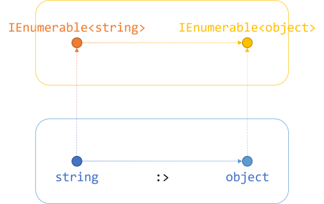

*A056 · 图 2 / Figure 2 · [图片来源 / Image source](https://blog.ploeh.dk/content/binary/functor-diagram-for-ienumerable.png)*

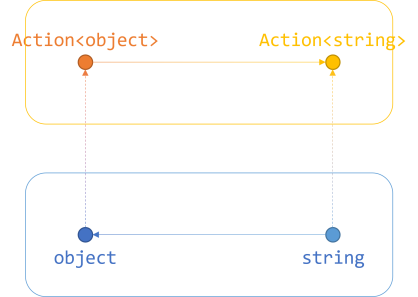

*A056 · 图 3 / Figure 3 · [图片来源 / Image source](https://blog.ploeh.dk/content/binary/contravariant-functor-diagram-for-action.png)*

[返回目录 / Back to catalogue](#catalogue)

---

<a id="a057"></a>

###### A057 · 逆变依赖注入

*Contravariant Dependency Injection*

[原文 / Source](https://blog.ploeh.dk/2022/03/21/contravariant-dependency-injection/) · 发布日期 / Published: 2022/03/21

**中文导读**

通过输入适配提供依赖，可解释“DI 是逆变函子”这句话；部分应用也可表达依赖组合。作者明确说此篇不是在推荐给函数式程序加入 DI 容器，而是分析结构，并通常偏好更简单、符合纯函数边界的设计。

**English**

Input adaptation offers one explanation of dependency injection in contravariant terms. Partial application provides another practical composition technique. The article analyzes the slogan's meaning while explicitly declining to endorse DI-container machinery as the preferred functional design.

**思考 / Study question**

部分应用何时已经足够？ / When is partial application sufficient?

[返回目录 / Back to catalogue](#catalogue)

---

<a id="a058"></a>

##### A058 · Profunctor（输入逆变、输出协变）

*Profunctors*

[原文 / Source](https://blog.ploeh.dk/2021/11/01/profunctors/) · 发布日期 / Published: 2021/11/01

**中文导读**

Profunctor 同时支持输入前置适配和输出后置适配。对核心函数 k，组合形状是 post∘k∘pre。普通函数是最常见实例，这为接口边界和契约的分析提供语言，但不能据此把每一个程序构件都断言为 Profunctor。

**English**

A profunctor combines contravariant input adaptation with covariant output adaptation. Ordinary functions supply the main practical example. Thinking in this form helps analyze boundaries and contracts, provided the relevant mappings and their laws are actually established.

**思考 / Study question**

输入与输出的箭头方向为何不同？ / Why do input and output mappings point differently?

[返回目录 / Back to catalogue](#catalogue)

---

<a id="a059"></a>

###### A059 · Reader 的 Profunctor 视角

*Reader as a profunctor*

[原文 / Source](https://blog.ploeh.dk/2021/11/08/reader-as-a-profunctor/) · 发布日期 / Published: 2021/11/08

**中文导读**

函数 A→B 可以同时改造成 C→D：用 C→A 接受新输入，再用 B→D 调整输出。这统一了前面的 Reader 两种函子视角，且可直接用函数复合实现，不一定需要 Reader 类。

**English**

A function can be adapted at both ends through pre- and postcomposition. This unifies Reader's input and output mapping perspectives. The abstraction is already present in plain functions, so an explicit Reader wrapper is optional for understanding the construction.

**思考 / Study question**

如何把三个函数接成一条管线？ / How do three functions form the adapted pipeline?

[返回目录 / Back to catalogue](#catalogue)

---

<a id="a060"></a>

##### A060 · 不变函子

*Invariant functors*

[原文 / Source](https://blog.ploeh.dk/2022/08/01/invariant-functors/) · 发布日期 / Published: 2022/08/01

**中文导读**

不变映射同时接收正向与反向转换，让类型既被生产又被消费的结构也能适配。文章关注同构值之间的转换。它比普通函子和逆变函子的使用条件更特殊；需要双向函数并不意味着每个用例都必须强制做无损转换。

**English**

Invariant mapping accepts transformations in both directions. This supports structures that both consume and produce their parameter. The article emphasizes isomorphic representations and uncommon uses; the two-function API is the central mechanism to distinguish from one-way mapping.

**思考 / Study question**

为何单个转换函数不够？ / Why might a single transformation be insufficient?

**原文配图 / Original illustrations**

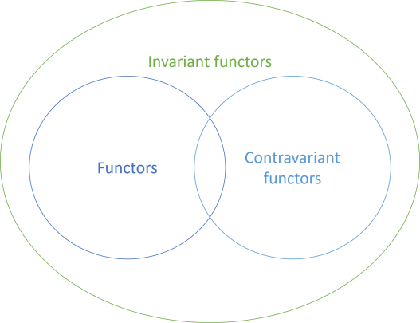

*A060 · 图 1 / Figure 1 · [图片来源 / Image source](https://blog.ploeh.dk/content/binary/invariant-functor-set-diagram.png)*

[返回目录 / Back to catalogue](#catalogue)

---

<a id="a061"></a>

###### A061 · 自同态不变函子

*Endomorphism as an invariant functor*

[原文 / Source](https://blog.ploeh.dk/2022/08/08/endomorphism-as-an-invariant-functor/) · 发布日期 / Published: 2022/08/08

**中文导读**

T→T 同时把 T 用在输入与输出，无法只靠普通 map 或 contramap 改成 U→U。给出 U→T 与 T→U，便可把原自同态夹在中间。文章由此展示不变结构，同时保留此前的幺半群结构。

**English**

An endomorphism uses the same parameter in input and output positions. Adapting both requires two transformations around the original function. This explains its invariant mapping behavior while keeping function-composition monoids as a separate property of the same structure.

**思考 / Study question**

自同态为何通常不能只做单向映射？ / Why does an endomorphism usually need two-way adaptation?

**原文配图 / Original illustrations**

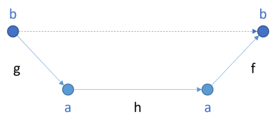

*A061 · 图 1 / Figure 1 · [图片来源 / Image source](https://blog.ploeh.dk/content/binary/invariant-map-diagram.png)*

[返回目录 / Back to catalogue](#catalogue)

---

<a id="a062"></a>

###### A062 · 自然变换的不变函子视角

*Natural transformations as invariant functors*

[原文 / Source](https://blog.ploeh.dk/2022/08/29/natural-transformations-as-invariant-functors/) · 发布日期 / Published: 2022/08/29

**中文导读**

文章考察自然变换中同时涉及输入输出的类型位置，通过两端的函子映射适配表示，特别连接到 State 的状态类型变换。此处不是说所有容器转换都天然有可逆性；要区分自然性条件、参数方向与具体同构要求。

**English**

The article adapts a parameter shared across a natural transformation using mappings at both ends. State representation changes provide a motivating application. Keep naturality, variance, and invertible representation changes distinct; they address related but different requirements.

**思考 / Study question**

转换状态表示时需保留哪些信息？ / What information must survive a state-representation conversion?

**原文配图 / Original illustrations**

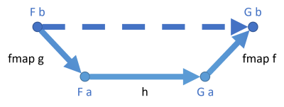

*A062 · 图 1 / Figure 1 · [图片来源 / Image source](https://blog.ploeh.dk/content/binary/invariant-natural-transformation-map-diagram.png)*

[返回目录 / Back to catalogue](#catalogue)

---

<a id="a063"></a>

###### A063 · 普通函子的不变视角

*Functors as invariant functors*

[原文 / Source](https://blog.ploeh.dk/2022/12/26/functors-as-invariant-functors/) · 发布日期 / Published: 2022/12/26

**中文导读**

已有 map 时，可定义 invmap：使用正向函数、忽略反向函数。于是协变函子也具有不变映射的形式。作者把它视为存在性结果，实用性有限；额外接受一个参数并不代表实现真的会使用它。

**English**

A covariant functor can expose invariant mapping by using the forward transformation alone. The reverse argument is ignored. This establishes an inclusion between abstractions, but the article treats it primarily as a structural observation rather than a compelling new application technique.

**思考 / Study question**

被忽略的反向参数有什么分析意义？ / What does the ignored reverse argument tell us?

[返回目录 / Back to catalogue](#catalogue)

---

<a id="a064"></a>

###### A064 · 逆变函子的不变视角

*Contravariant functors as invariant functors*

[原文 / Source](https://blog.ploeh.dk/2023/02/06/contravariant-functors-as-invariant-functors/) · 发布日期 / Published: 2023/02/06

**中文导读**

逆变函子同样可提供 invmap，不过只使用反向函数、忽略正向函数。它与上一篇对称，说明不变抽象能容纳协变与逆变两类结构。实际 API 是否值得暴露此方法，应看通用代码的需要。

**English**

A contravariant structure supplies invariant mapping through the backward transformation alone. This mirrors the preceding covariant construction. The result explains how the abstractions relate, while leaving API design to the actual needs of clients and generic code.

**思考 / Study question**

与上一篇相比，哪个参数被使用？ / Which argument is used compared with the preceding article?

[返回目录 / Back to catalogue](#catalogue)

---

<a id="a065"></a>

##### A065 · Monad

*Monads*

[原文 / Source](https://blog.ploeh.dk/2022/03/28/monads/) · 发布日期 / Published: 2022/03/28

**中文导读**

map 遇到 A→M<B> 会产生嵌套，Bind 可在映射后按该结构的语义展平。Monad 还要求把普通值放入结构的 pure/return，并满足法则。C# SelectMany 是常见入口；Monad 不意味着所有实例都处理副作用或修改状态。

**English**

Bind composes a wrapped value with a function returning another wrapped value. Flattening resolves the resulting nesting according to the structure's semantics. Together with value injection and laws, this explains monads without reducing them to mutation or effect handling.

**思考 / Study question**

map 与 Bind 的函数参数有何不同？ / How do the function arguments of map and Bind differ?

**原文配图 / Original illustrations**

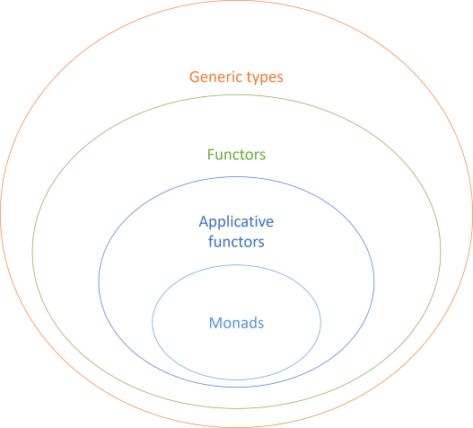

*A065 · 图 1 / Figure 1 · [图片来源 / Image source](https://blog.ploeh.dk/content/binary/functors-applicatives-monads.png)*

[返回目录 / Back to catalogue](#catalogue)

---

<a id="a066"></a>

###### A066 · Kleisli 复合

*Kleisli composition*

[原文 / Source](https://blog.ploeh.dk/2022/04/04/kleisli-composition/) · 发布日期 / Published: 2022/04/04

**中文导读**

普通函数的输出能直接交给下一个函数；A→M<B> 与 B→M<C> 则需要 Bind 来衔接。Kleisli 复合把它们合为 A→M<C>，让可失败、异步等计算也有统一组合形式。Monad 法则保证这种复合及其单位行为合理。

**English**

Kleisli composition connects functions whose results remain inside a monadic structure. Bind bridges the mismatch between a wrapped intermediate result and the next function's plain input. The construction makes multi-step computation composable under the corresponding identity and associativity laws.

**思考 / Study question**

中间的 M<B> 怎样交给下一步？ / How does the intermediate M<B> reach the next step?

[返回目录 / Back to catalogue](#catalogue)

---

<a id="a067"></a>

###### A067 · Monad 法则

*Monad laws*

[原文 / Source](https://blog.ploeh.dk/2022/04/11/monad-laws/) · 发布日期 / Published: 2022/04/11

**中文导读**

左单位律表示先包装再 Bind 等于直接调用；右单位律表示 Bind 到包装函数不改变计算；结合律表示串联的分组不影响结果。法则讨论语义相等，不是要求执行对象引用相同，也不自动保证每个有 SelectMany 的类合法。

**English**

The laws constrain value injection and sequencing so that administrative wrapping is neutral and regrouped chains agree. Equality concerns the chosen computation semantics. Merely naming a method SelectMany cannot establish these guarantees for a custom implementation.

**思考 / Study question**

右单位律中的“相等”如何观察？ / How can equality in the right identity law be observed?

[返回目录 / Back to catalogue](#catalogue)

---

<a id="a068"></a>

###### A068 · 列表 Monad

*The List monad*

[原文 / Source](https://blog.ploeh.dk/2022/04/19/the-list-monad/) · 发布日期 / Published: 2022/04/19

**中文导读**

Bind 对每个元素产生一个列表，再按顺序拼接这些列表；pure 把值变成单元素列表。它适合表达依赖前一选择的多种结果。普通列表 Monad 的展平不是去重、排序或逐项配对，且教学模型假定可重复观察的序列行为。

**English**

List sequencing expands each input into an ordered collection and concatenates the results. A singleton injects a plain value. This captures dependent alternatives without implying deduplication, sorting, or zipping, and relies on a suitable deterministic sequence interpretation.

**思考 / Study question**

列表 Bind 为什么会改变元素数量？ / Why can list Bind change the number of elements?

[返回目录 / Back to catalogue](#catalogue)

---

<a id="a069"></a>

###### A069 · Maybe Monad

*The Maybe monad*

[原文 / Source](https://blog.ploeh.dk/2022/04/25/the-maybe-monad/) · 发布日期 / Published: 2022/04/25

**中文导读**

当当前值存在时，Bind 调用下一个可能失败的函数；一旦缺失，后续步骤不再得到值。它避免 Maybe<Maybe<T>> 嵌套，让多个可能无结果的步骤串联。只需要最终缺失信息时很简洁，但不会保留具体失败原因。

**English**

Optional sequencing invokes the next partial-result function only for a present value. Missing results stop the value pipeline. This removes nested optional wrappers and simplifies composition, while intentionally carrying less failure information than a richer result type.

**思考 / Study question**

何时应把 Maybe 换成 Either？ / When should Maybe be replaced with Either?

[返回目录 / Back to catalogue](#catalogue)

---

<a id="a070"></a>

###### A070 · Either Monad

*An Either monad*

[原文 / Source](https://blog.ploeh.dk/2022/05/09/an-either-monad/) · 发布日期 / Published: 2022/05/09

**中文导读**

固定错误类型后，Bind 串联成功值，失败则保留 Left 并短路。文章以解析与正数检查展示不抛异常的组合方式。它与累积所有字段错误的验证 Applicative 不同：后一步可能依赖成功结果，因此不能照同一规则收集所有错误。

**English**

Either sequencing keeps explicit errors while composing successful computations. It suits dependent parsing and validation steps that stop on failure. This behavior differs from accumulating validation, whose independent branches use a deliberately different combination rule.

**思考 / Study question**

短路错误与累积错误分别适合什么情境？ / When are short-circuiting and accumulating errors appropriate?

[返回目录 / Back to catalogue](#catalogue)

---

<a id="a071"></a>

###### A071 · Identity Monad

*The Identity monad*

[原文 / Source](https://blog.ploeh.dk/2022/05/16/the-identity-monad/) · 发布日期 / Published: 2022/05/16

**中文导读**

Identity 的 Bind 只是取出值并交给函数，展平也只是去掉一层包装；pure 再包起来。没有额外效果使法则格外直观。作者没有给出 C# 或 F# 的直接应用需求，阅读价值主要是看清 Monad 的最小形式。

**English**

With no extra computational behavior, Identity makes injection, flattening, and sequencing almost transparent. It is a useful reference point for understanding the machinery, even when explicit Identity wrappers contribute little to ordinary C# or F# application code.

**思考 / Study question**

移除效果之后 Monad 还剩下什么？ / What remains of a monad when extra behavior is removed?

[返回目录 / Back to catalogue](#catalogue)

---

<a id="a072"></a>

###### A072 · Lazy Monad

*The Lazy monad*

[原文 / Source](https://blog.ploeh.dk/2022/05/30/the-lazy-monad/) · 发布日期 / Published: 2022/05/30

**中文导读**

前一个延迟结果可决定后一个延迟计算，Bind 把这种依赖仍封装为一个延迟过程。它比独立的 Lazy Applicative 组合更灵活。法则示例使用纯函数；若求值产生可观察副作用，应额外分析求值次数与时机。

**English**

Lazy sequencing defers a result-dependent next computation. This extends independent lazy combination to a dependent chain. Pure functions clarify the laws, while side-effectful evaluation requires care about when computations run and how many times results are demanded.

**思考 / Study question**

依赖下一步时，延迟性如何保留？ / How is deferral retained when the next step depends on a result?

[返回目录 / Back to catalogue](#catalogue)

---

<a id="a073"></a>

###### A073 · 异步 Monad

*Asynchronous monads*

[原文 / Source](https://blog.ploeh.dk/2022/06/06/asynchronous-monads/) · 发布日期 / Published: 2022/06/06

**中文导读**

Bind 等待前一个异步结果，再取得并衔接后一个异步计算；join 把嵌套的异步表示展平。Task 与 F# Async 提供具体例子。任务故障、取消、热启动及并行策略仍是运行语义，不由“这是 Monad”一句话完整解释。

**English**

Asynchronous bind sequences a next computation using the preceding result. Flattening resolves nested asynchronous representations. The shared abstraction organizes workflows, but does not erase differences in cancellation, failures, eager starts, scheduling, or the decision to run work concurrently.

**思考 / Study question**

异步串联与并行组合为何不同？ / Why does asynchronous sequencing differ from parallel combination?

[返回目录 / Back to catalogue](#catalogue)

---

<a id="a074"></a>

###### A074 · State Monad

*The State monad*

[原文 / Source](https://blog.ploeh.dk/2022/06/20/the-state-monad/) · 发布日期 / Published: 2022/06/20

**中文导读**

State 的 Bind 先执行第一步，取得结果和新状态，再把新状态送入下一步。状态变化因此成为显式的纯函数输入输出，不必原地修改对象。pure 返回值但保持状态；该结构是工具，不能取代针对问题寻找更简单算法。

**English**

State bind threads each returned state into the next computation while exposing intermediate results for dependent steps. Mutation becomes explicit data flow. The abstraction supports stateful algorithms through pure functions, but should still be weighed against simpler problem-specific solutions.

**思考 / Study question**

下一步接收旧状态还是新状态？ / Does the next step receive the old state or the new one?

[返回目录 / Back to catalogue](#catalogue)

---

<a id="a075"></a>

###### A075 · Reader Monad

*The Reader monad*

[原文 / Source](https://blog.ploeh.dk/2022/11/14/the-reader-monad/) · 发布日期 / Published: 2022/11/14

**中文导读**

Reader 的多个步骤读取同一个环境。Bind 先在环境 r 下得到 a，再用 a 选择下一个 Reader，并仍以 r 执行它。join 的典型形式是 k(r)(r)。这帮助共享配置或依赖，但不是说所有依赖都应隐式塞入巨大环境。

**English**

Reader sequencing shares one environment across result-dependent computations. The intermediate result chooses the next reader, which receives that same environment. This exposes a useful property of functions while leaving the scope and organization of dependencies as a design decision.

**思考 / Study question**

Reader Bind 会更新环境吗？ / Does Reader Bind update its environment?

[返回目录 / Back to catalogue](#catalogue)

---

<a id="a076"></a>

###### A076 · 响应式 Monad

*Reactive monad*

[原文 / Source](https://blog.ploeh.dk/2025/03/03/reactive-monad/) · 发布日期 / Published: 2025/03/03

**中文导读**

Rx 的 SelectMany 可把每个事件变成一个新流，再按其规则合并为输出流。文章用有限、同步例子展示 Monad 法则。实际系统要进一步说明时序、并发、取消、错误和订阅副作用；不能把流的组合简化成只有列表拼接。

**English**

Reactive SelectMany combines streams generated from individual events. The article demonstrates monadic laws through finite examples. Practical stream semantics also include timing and subscriptions, so the analogy to list expansion must be interpreted within the chosen reactive operators.

**思考 / Study question**

换一个流合并算子会改变哪些语义？ / Which semantics change when the stream-combination operator changes?

[返回目录 / Back to catalogue](#catalogue)

---

<a id="a077"></a>

###### A077 · IO Monad

*The IO monad*

[原文 / Source](https://blog.ploeh.dk/2023/01/09/the-io-monad/) · 发布日期 / Published: 2023/01/09

**中文导读**

IO 的 Bind 使前一动作的结果决定后一动作，组合完成后仍是动作表示。Haskell 用该结构组织效果而不在纯代码中直接执行；C# 示例只有函数包装形状，不具备同等语言约束。应区分“描述动作”与“执行动作”。

**English**

IO sequencing builds actions whose later steps depend on earlier results. The distinction between describing and executing an action is central. A C# wrapper illustrates composition but cannot reproduce Haskell's effect discipline merely through an API that looks similar.

**思考 / Study question**

动作何时被描述，何时被执行？ / When is an action described, and when is it executed?

[返回目录 / Back to catalogue](#catalogue)

---

<a id="a078"></a>

###### A078 · 测试数据生成器 Monad

*Test Data Generator monad*

[原文 / Source](https://blog.ploeh.dk/2023/02/27/test-data-generator-monad/) · 发布日期 / Published: 2023/02/27

**中文导读**

需要后一随机值依赖前一随机结果时，使用生成器 Bind，例如先生成日期，再生成匹配该日期的编号部分。它把分层生成保持在同一个生成器中，避免嵌套包装；随机状态及收缩行为仍由具体测试库定义。

**English**

Generator bind supports data dependencies between generated components. An earlier value can determine the next generator, producing structured valid data in one pipeline. The abstraction handles nesting, while each testing library supplies its own random-state and shrinking behavior.

**思考 / Study question**

何时独立生成会产生无效数据？ / When would independent generation produce invalid data?

[返回目录 / Back to catalogue](#catalogue)

---

<a id="a079"></a>

##### A079 · 函子之间的关系

*Functor relationships*

[原文 / Source](https://blog.ploeh.dk/2022/07/11/functor-relationships/) · 发布日期 / Published: 2022/07/11

**中文导读**

这一小系列研究结构之间的转换，以及把函子做成积、和、嵌套结构的方法。仅能分别 map 并不足以保证任意嵌套 Monad 可直接展平。阅读时始终记录每条结论需要 Functor、Applicative、Traversable 还是更强条件。

**English**

This branch investigates transformations and combinations between structures. Products, sums, nesting, and traversals require different capabilities. Keeping those requirements explicit prevents a valid statement about functor composition from becoming an invalid claim about arbitrary monadic composition.

**思考 / Study question**

每个操作要求哪一级抽象？ / Which abstraction is required by each operation?

[返回目录 / Back to catalogue](#catalogue)

---

<a id="a080"></a>

###### A080 · 自然变换

*Natural transformations*

[原文 / Source](https://blog.ploeh.dk/2022/07/18/natural-transformations/) · 发布日期 / Published: 2022/07/18

**中文导读**

自然变换改变函子形式，而对元素类型保持统一：如取列表首项得到 Maybe，或把 Maybe 变成零或一个元素的列表。它应与 map 相容。转换可以丢失数据，通常不要求逆变换，因而不能把它自动当作同构。

**English**

A natural transformation changes the surrounding structure uniformly over value types and commutes with mapping. Safe head and optional-to-list conversion provide concrete examples. Information may be discarded, so naturality does not imply an inverse or a lossless representation change.

**思考 / Study question**

先转换再 map 与先 map 再转换是否一致？ / Does transformation commute with mapping?

[返回目录 / Back to catalogue](#catalogue)

---

<a id="a081"></a>

###### A081 · 函子积

*Functor products*

[原文 / Source](https://blog.ploeh.dk/2024/09/16/functor-products/) · 发布日期 / Published: 2024/09/16

**中文导读**

若 F 与 G 都可映射，Pair<F<A>,G<A>> 可分别 map 两个成员，从而也是函子。文章用 Zipper、非空集合等结构展示这种构造。这里是“函子的积”，与前面“值具有幺半群结构的元组”关注不同性质。

**English**

A product of functors maps each constituent structure using the same value transformation. This construction helps explain composite generic data such as zippers and nonempty collections. It concerns mapping structure, rather than automatically assigning a combining operation to the stored values.

**思考 / Study question**

为何两个成员都要应用同一转换？ / Why must both components apply the same transformation?

[返回目录 / Back to catalogue](#catalogue)

---

<a id="a082"></a>

###### A082 · 函子和

*Functor sums*

[原文 / Source](https://blog.ploeh.dk/2024/10/14/functor-sums/) · 发布日期 / Published: 2024/10/14

**中文导读**

择一使用 F<A> 或 G<A> 的结构，只需映射当前分支，保留选择标记，就可成为函子。文章以区间端点、树和导航碎屑说明。积是同时有，和是择一有，这个区别与元组及 Either 的对照一致。

**English**

An alternative between functor structures maps the active branch and preserves the choice. Endpoint and tree examples make the construction concrete. Distinguishing alternatives from simultaneous products provides a reusable way to recognize mapping behavior in composite data types.

**思考 / Study question**

和类型与积类型的“包含”如何不同？ / How does containment differ between sums and products?

[返回目录 / Back to catalogue](#catalogue)

---

<a id="a083"></a>

###### A083 · 函子复合

*Functor compositions*

[原文 / Source](https://blog.ploeh.dk/2024/10/28/functor-compositions/) · 发布日期 / Published: 2024/10/28

**中文导读**

F<G<A>> 的映射是在外层 map 内层的 map，因此两个函子嵌套后仍是函子。它没有自动交换容器次序，也没有自动获得 Monad。Task<List<A>> 与 List<Task<A>> 能否互换，需要下一篇的遍历能力。

**English**

Nested functors support mapping through both layers. This closure result neither swaps those layers nor supplies a monadic flattening operation. The distinction becomes practical when collections of tasks and tasks of collections need different execution arrangements.

**思考 / Study question**

嵌套可 map 是否等于嵌套可 Bind？ / Does nested mapping imply nested binding?

[返回目录 / Back to catalogue](#catalogue)

---

<a id="a084"></a>

###### A084 · 遍历与顺序交换

*Traversals*

[原文 / Source](https://blog.ploeh.dk/2024/11/11/traversals/) · 发布日期 / Published: 2024/11/11

**中文导读**

sequence 将 T<F<A>> 变成 F<T<A>>，要求外层 T 可遍历、内层 F 为 Applicative；traverse 则先应用 A→F<B> 再完成类似组合。列表任务是熟悉实例，但 Foldable 加 Functor 并不自动足以构造所有遍历。

**English**

Sequence exchanges a traversable outer structure with an applicative inner one. Traverse combines effectful mapping with that exchange. Lists of tasks illustrate the need, but traversal requires its own lawful capability rather than merely possessing an unrelated fold and map.

**思考 / Study question**

为什么只有 fold 与 map 还不够？ / Why might fold and map be insufficient for traversal?

**原文配图 / Original illustrations**

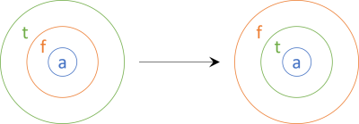

*A084 · 图 1 / Figure 1 · [图片来源 / Image source](https://blog.ploeh.dk/content/binary/traversal-sequence.png)*

[返回目录 / Back to catalogue](#catalogue)

---

<a id="a085"></a>

###### A085 · 嵌套 Monad

*Nested monads*

[原文 / Source](https://blog.ploeh.dk/2024/11/25/nested-monads/) · 发布日期 / Published: 2024/11/25

**中文导读**

某些组合如 Task<Maybe<A>> 可定义统一 Bind，但任意两个 Monad 嵌套并不自动仍是 Monad。文中从具体组合探索一般形状；不同状态与失败层次可能影响最终保留哪些结果。推广需检查相应交换结构和法则。

**English**

Some nested arrangements admit coherent monadic sequencing, including asynchronous optional results. This is not a universal closure rule for arbitrary monads. Layer order and interaction matter, especially when state and failure are combined, so generalizations require additional structure and laws.

**思考 / Study question**

失败之后状态是否应被保留？ / Should state survive a failure in a nested computation?

**原文配图 / Original illustrations**

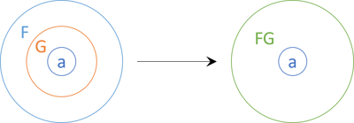

*A085 · 图 1 / Figure 1 · [图片来源 / Image source](https://blog.ploeh.dk/content/binary/nested-monads-transformed-to-single-monad.png)*

[返回目录 / Back to catalogue](#catalogue)

---

### 第三部分：软件设计同构 / Part III: Software design isomorphisms

<a id="a086"></a>

#### A086 · 软件设计同构

*Software design isomorphisms*

[原文 / Source](https://blog.ploeh.dk/2018/01/08/software-design-isomorphisms/) · 发布日期 / Published: 2018/01/08

**中文导读**

若两种表示可来回无损转换，就能把分析归约到一个标准形式。软件重构提供这样的桥梁，帮助把对象语言中的方法、参数与继承转换成更便于分析的函数和积。可表达能力相同，不代表可读性、性能和维护成本相同。

**English**

Lossless representation changes let an analysis move to a convenient canonical form. Refactorings connect methods, parameter structures, and object designs to functional representations. Equivalent expressive power still allows meaningful differences in clarity, cost, and suitability for a particular language.

**思考 / Study question**

等价的两个 API 为何仍值得选择？ / Why choose between APIs with equivalent expressive power?

**原文配图 / Original illustrations**

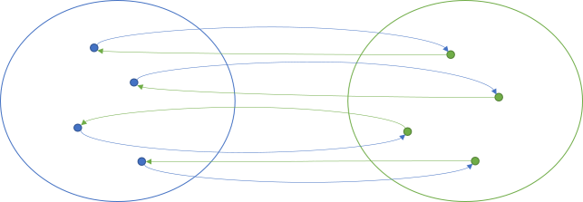

*A086 · 图 1 / Figure 1 · [图片来源 / Image source](https://blog.ploeh.dk/content/binary/isomorphism.png)*

[返回目录 / Back to catalogue](#catalogue)

---

<a id="a087"></a>

##### A087 · Unit 同构

*Unit isomorphisms*

[原文 / Source](https://blog.ploeh.dk/2018/01/15/unit-isomorphisms/) · 发布日期 / Published: 2018/01/15

**中文导读**

Unit 只有一个值，可作为不携带业务信息的返回结果，令无结果操作也进入统一函数模型。文章把 void、F# unit 等作跨语言对应；真实语言中的返回语法和副作用仍有差异，Unit 本身更不会表示 null 或失败。

**English**

A one-value type supplies a uniform return shape for operations that convey no result information. The article relates this to void-style methods across languages. Unit should remain distinct from absence, failure, and the effects an operation may perform.

**思考 / Study question**

Unit 与 Maybe 的 Nothing 有何不同？ / How does Unit differ from Maybe's Nothing?

**原文配图 / Original illustrations**

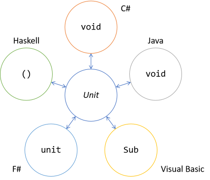

*A087 · 图 1 / Figure 1 · [图片来源 / Image source](https://blog.ploeh.dk/content/binary/unit-isomorphisms.png)*

[返回目录 / Back to catalogue](#catalogue)

---

<a id="a088"></a>

##### A088 · 函数同构

*Function isomorphisms*

[原文 / Source](https://blog.ploeh.dk/2018/01/22/function-isomorphisms/) · 发布日期 / Published: 2018/01/22

**中文导读**

实例方法可通过显式传入实例变成静态函数，也可由闭包捕获实例状态；反向转换同样可构造。借这些重构，可把方法的分析转为函数分析。转换必须保留共享状态与调用行为，不能把每个实例都当作互不相关的函数副本。

**English**

Making the receiver explicit connects instance methods to ordinary functions. Closures supply another representation by retaining associated data. These refactorings provide an analytical bridge, provided they preserve the relevant state-sharing and invocation behavior of the original design.

**思考 / Study question**

实例自身在函数签名中放在哪里？ / Where does the instance appear in the function signature?

**原文配图 / Original illustrations**

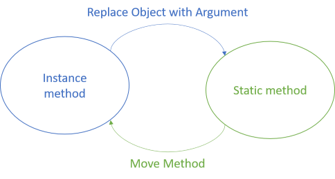

*A088 · 图 1 / Figure 1 · [图片来源 / Image source](https://blog.ploeh.dk/content/binary/function-isomorphism.png)*

[返回目录 / Back to catalogue](#catalogue)

---

<a id="a089"></a>

##### A089 · 参数列表同构

*Argument list isomorphisms*

[原文 / Source](https://blog.ploeh.dk/2018/01/29/argument-list-isomorphisms/) · 发布日期 / Published: 2018/01/29

**中文导读**

多个参数、元组参数与参数对象，可在信息不丢失时互相转换。其选型主要影响命名、调用方便程度和领域表达。分析时可把它们看作积类型；实现时应检查字段不变量和构造限制是否使转换不再无损。

**English**

Argument lists, tuples, and parameter objects can represent the same supplied information. Their practical differences include naming and domain clarity. Treating them as products helps analysis, while constructor restrictions or additional invariants can limit a concrete lossless conversion.

**思考 / Study question**

什么时候参数对象优于元组？ / When is a parameter object preferable to a tuple?

**原文配图 / Original illustrations**

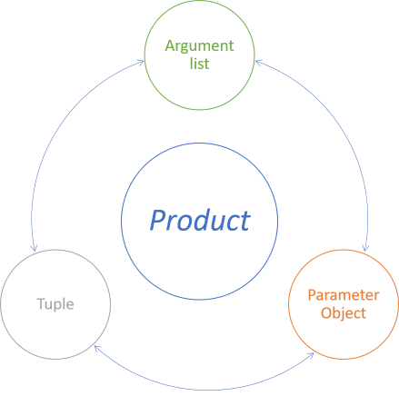

*A089 · 图 1 / Figure 1 · [图片来源 / Image source](https://blog.ploeh.dk/content/binary/argument-list-isomorphisms.png)*

[返回目录 / Back to catalogue](#catalogue)

---

<a id="a090"></a>

##### A090 · 柯里化与反柯里化同构

*Uncurry isomorphisms*

[原文 / Source](https://blog.ploeh.dk/2018/02/05/uncurry-isomorphisms/) · 发布日期 / Published: 2018/02/05

**中文导读**

A→B→C 与 (A,B)→C 可由 curry 和 uncurry 互换。前者支持先提供部分参数，后者更接近对象语言常见调用形状。这个桥梁使函数式文献的签名可转译为 C# 方法，不必把语法差异误认成计算能力差异。

**English**

Currying separates arguments into successive function applications; uncurrying groups them into one product input. The conversions bridge functional signatures and familiar multi-argument methods. Partial application becomes more visible in the curried representation without creating a different underlying calculation.

**思考 / Study question**

柯里化如何帮助先提供依赖？ / How does currying help supply a dependency in advance?

[返回目录 / Back to catalogue](#catalogue)

---

<a id="a091"></a>

##### A091 · 对象同构

*Object isomorphisms*

[原文 / Source](https://blog.ploeh.dk/2018/02/12/object-isomorphisms/) · 发布日期 / Published: 2018/02/12

**中文导读**

把对象的一组行为看作捕获共享数据的函数集合，可得到“对象是函数积”的分析视角。它并非建议用元组闭包重写整个 C# 项目，而是把已知的函数与积性质带到对象设计中；状态共享是该表示的关键。

**English**

An object's behaviors can be represented by functions sharing captured data. This product-of-functions perspective supports structural analysis. The article uses it as a bridge to known functional properties, not as a recommendation to replace everyday classes with tuples of closures.

**思考 / Study question**

多个闭包怎样共享同一对象状态？ / How can several closures share one object's state?

[返回目录 / Back to catalogue](#catalogue)

---

<a id="a092"></a>

##### A092 · 抽象类与依赖注入同构

*Abstract class isomorphism*

[原文 / Source](https://blog.ploeh.dk/2018/02/19/abstract-class-isomorphism/) · 发布日期 / Published: 2018/02/19

**中文导读**

把抽象方法提供的变化点提取成接口，再注入具体实现，可把抽象类设计转成组合式设计。文章借迷宫 Builder 说明转换，帮助重读 GoF 示例。分析须保留模板步骤、依赖和访问约束；作者对抽象类的偏好属于设计主张。

**English**

Extracting variation points into injected interfaces turns an abstract-class design into composition. The maze example makes this bridge useful for rereading classic patterns. Preserve orchestration and dependency behavior, while distinguishing the refactoring argument from the author's broader design preferences.

**思考 / Study question**

哪个方法成为被注入的变化点？ / Which method becomes the injected variation point?

**原文配图 / Original illustrations**

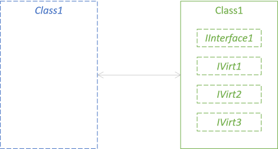

*A092 · 图 1 / Figure 1 · [图片来源 / Image source](https://blog.ploeh.dk/content/binary/abstract-class-to-interfaces-isomorphism.png)*

[返回目录 / Back to catalogue](#catalogue)

---

<a id="a093"></a>

##### A093 · 继承与组合同构

*Inheritance-composition isomorphism*

[原文 / Source](https://blog.ploeh.dk/2018/02/26/inheritance-composition-isomorphism/) · 发布日期 / Published: 2018/02/26

**中文导读**

用于复用的基类逻辑可移到一个被委托对象中，再把必要的可变行为抽成接口。文章研究的是可由重构互换的特定形状，支持优先考虑组合；它不证明所有语言层面的继承关系与对象身份都能机械替换。

**English**

Delegation can replace a particular reuse-oriented inheritance arrangement. Separating shared behavior from variation points makes the corresponding composition explicit. The example supports a refactoring choice, rather than proving that every inheritance feature or identity relationship is interchangeable in all languages.

**思考 / Study question**

转换时 base 调用应变成什么？ / What replaces a base-method call after delegation?

[返回目录 / Back to catalogue](#catalogue)

---

<a id="a094"></a>

##### A094 · Tester–Doer 同构

*Tester-Doer isomorphisms*

[原文 / Source](https://blog.ploeh.dk/2019/07/15/tester-doer-isomorphisms/) · 发布日期 / Published: 2019/07/15

**中文导读**

先判断再执行、TryParse 风格及 Maybe，可表达类似的成功或失败结果。Maybe 将判断与结果合在一次操作中，更易组合。具体可变环境中，Tester 与 Doer 之间状态可能变化，因此应检查往返所需假设，不能把双次调用总当成单次计算。

**English**

Tester–Doer, Try-style APIs, and optional results can encode corresponding outcomes. Maybe packages the decision with the result and composes more cleanly. In concrete mutable settings, a check followed by a separate action introduces assumptions about stability that deserve explicit attention.

**思考 / Study question**

检查后状态改变会造成什么问题？ / What happens if state changes after the check?

**原文配图 / Original illustrations**

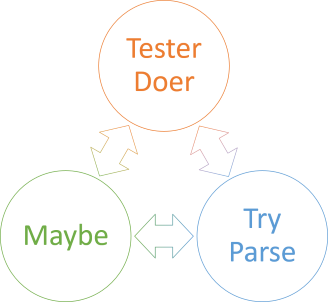

*A094 · 图 1 / Figure 1 · [图片来源 / Image source](https://blog.ploeh.dk/content/binary/tester-doer-try-parse-maybe-isomorphism.png)*

[返回目录 / Back to catalogue](#catalogue)

---

<a id="a095"></a>

##### A095 · Result 与异常：并非严格同构

*Result isomorphism*

[原文 / Source](https://blog.ploeh.dk/2025/10/15/result-isomorphism/) · 发布日期 / Published: 2025/10/15

**中文导读**

文章用受检异常与 Result 的重构解释两者的联系，但明确指出并非真正同构。异常有控制流、堆栈与语言语义，Result 是显式数据；转换不一定保存全部观察行为。选择还受语言习惯及跨库互操作影响。

**English**

The article compares explicit results with exception-based failure and then rejects a strict isomorphism claim. Language-level control flow and other observable semantics differ. Refactoring between styles remains possible in useful cases, but the choice has consequences beyond the success-or-error shape.

**思考 / Study question**

哪些异常信息会在转换中丢失？ / Which exception information might be lost during conversion?

**原文配图 / Original illustrations**

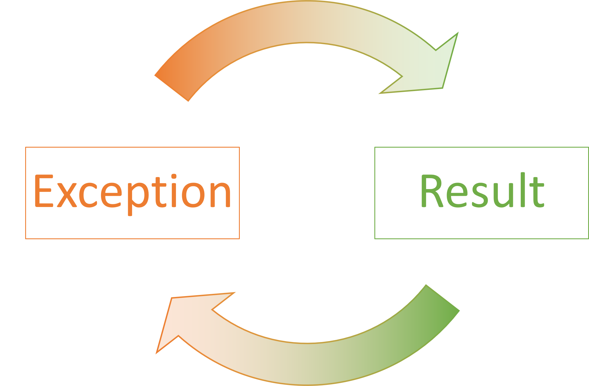

*A095 · 图 1 / Figure 1 · [图片来源 / Image source](https://blog.ploeh.dk/content/binary/result-exception-equivalence.png)*

[返回目录 / Back to catalogue](#catalogue)

---

<a id="a096"></a>

##### A096 · Builder 的多种同构表示

*Builder isomorphisms*

[原文 / Source](https://blog.ploeh.dk/2020/02/10/builder-isomorphisms/) · 发布日期 / Published: 2020/02/10

**中文导读**

GoF Builder、Fluent Builder 和不可变 Fluent Builder，可在示例中表示同一构建任务。Fluent 形式让修改步骤更易组合，不可变形式则返回新构建状态。观察其表示关系，可为下一篇将 Builder 理解为自同态打下基础。

**English**

The examples relate classic, fluent, and immutable fluent construction APIs. They can express corresponding work while offering different composition and usage characteristics. This representation analysis prepares the later view of builder modifiers as transformations composed over construction state.

**思考 / Study question**

返回 this 与返回新 Builder 有何影响？ / What changes when a builder returns itself or a new instance?

**原文配图 / Original illustrations**

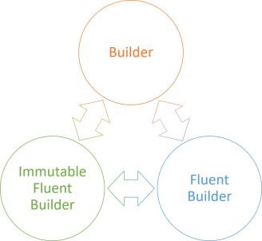

*A096 · 图 1 / Figure 1 · [图片来源 / Image source](https://blog.ploeh.dk/content/binary/builder-fluent-builder-isomorphism.png)*

[返回目录 / Back to catalogue](#catalogue)

---

### 第四部分：Church 编码 / Part IV: Church encoding

<a id="a097"></a>

#### A097 · Church 编码

*Church encoding*

[原文 / Source](https://blog.ploeh.dk/2018/05/22/church-encoding/) · 发布日期 / Published: 2018/05/22

**中文导读**

Church 编码用函数及其消去方式表示数据，帮助在没有内建和类型的语言中表达互斥分支。系列从布尔与自然数走到可选值、Either 和支付类型。目的在于理解表示的可能性，不是要求生产代码都放弃语言内建数据类型。

**English**

Church encoding represents data through functions that describe how it is consumed. The examples develop alternatives and recursion from small foundations. Its pedagogical value is understanding representation, rather than replacing every practical datatype with a hand-written functional encoding.

**思考 / Study question**

通过“如何使用”能否完整表示数据？ / Can data be represented by how it is consumed?

[返回目录 / Back to catalogue](#catalogue)

---

<a id="a098"></a>

##### A098 · Church 编码的布尔值

*Church-encoded Boolean values*

[原文 / Source](https://blog.ploeh.dk/2018/05/24/church-encoded-boolean-values/) · 发布日期 / Published: 2018/05/24

**中文导读**

布尔值可表示为选择两个候选结果之一的函数；true 选第一项，false 选第二项。逻辑 AND、OR、NOT 可据此组合出来。严格语言中，候选值与延迟候选计算不同，编码分支时应留意是否提前执行了两边。

**English**

A Boolean can be represented as a choice between two supplied alternatives. Logical operations then emerge from composing these selectors. In an eager language, supplied values and deferred branch computations behave differently, so evaluation strategy matters when applying the idea.

**思考 / Study question**

严格求值会提前运行未选中的分支吗？ / Can eager evaluation run an unselected branch?

[返回目录 / Back to catalogue](#catalogue)

---

<a id="a099"></a>

##### A099 · Church 编码的自然数

*Church-encoded natural numbers*

[原文 / Source](https://blog.ploeh.dk/2018/05/28/church-encoded-natural-numbers/) · 发布日期 / Published: 2018/05/28

**中文导读**

从零与后继出发，可将自然数表示为对某种初值反复施加步骤的行为。文章借 Peano 表示推导加法、判零、奇偶等操作。阅读重点是递归数据及其消去方式；实际整数的效率与溢出处理是另一层实现问题。

**English**

Natural numbers arise from a zero case and repeated successor construction. Encoding their elimination supports arithmetic and predicates. This exposes recursive representation and iteration, while ordinary numeric efficiency and bounded-machine arithmetic remain separate implementation concerns.

**思考 / Study question**

后继分支如何对应重复应用函数？ / How does a successor correspond to repeated function application?

[返回目录 / Back to catalogue](#catalogue)

---

<a id="a100"></a>

##### A100 · Church 编码的 Maybe

*Church-encoded Maybe*

[原文 / Source](https://blog.ploeh.dk/2018/06/04/church-encoded-maybe/) · 发布日期 / Published: 2018/06/04

**中文导读**

Maybe 的两种分支可用一个消去接口统一处理：缺失提供默认结果，存在把值交给处理函数。这样可从函数构造可选值而无需依赖 null。相同接口还能定义谓词和映射，且调用者必须考虑两种情况。

**English**

Optional data can be represented through an eliminator that handles absence and presence. A present value is passed to a handler; absence supplies an alternative result. This gives an explicit model of optionality without relying on null references.

**思考 / Study question**

消去 Maybe 时为何需要两个分支？ / Why are two cases needed to eliminate Maybe?

[返回目录 / Back to catalogue](#catalogue)

---

<a id="a101"></a>

##### A101 · Church 编码的 Either

*Church-encoded Either*

[原文 / Source](https://blog.ploeh.dk/2018/06/11/church-encoded-either/) · 发布日期 / Published: 2018/06/11

**中文导读**

Either 的消去接口接收 Left 与 Right 两个处理函数，两者产出统一结果类型。相比 Maybe，它可携带具体错误或另一类数据。文章用它建立显式错误处理，重要的是穷尽所有分支，而不是依赖运行时猜测子类型。

**English**

Either consumption uses one handler for each possible case, with a shared result type. This preserves meaningful failure data and supports explicit handling. The representation makes alternatives visible to callers rather than leaving case discovery to runtime casts or implicit exception flow.

**思考 / Study question**

两个分支为何需要同一结果类型？ / Why do both handlers return the same result type?

[返回目录 / Back to catalogue](#catalogue)

---

<a id="a102"></a>

##### A102 · Church 编码的支付类型

*Church-encoded payment types*

[原文 / Source](https://blog.ploeh.dk/2018/06/18/church-encoded-payment-types/) · 发布日期 / Published: 2018/06/18

**中文导读**

领域和类型不限于两个分支。支付示例有三种互斥情况，因此消去接口接收三种处理行为，每种可有不同输入但统一输出。它展示如何将函数式的领域声明翻译为 C# API，并为 Visitor 的重构关系做准备。

**English**

A domain-specific alternative can have more than two cases. The payment model uses three corresponding handlers to consume its mutually exclusive variants. Translating this structure into C# connects functional domain modeling with the Visitor representation developed later.

**思考 / Study question**

增加一种支付情况应修改哪些位置？ / Which places must change when a payment case is added?

**原文配图 / Original illustrations**

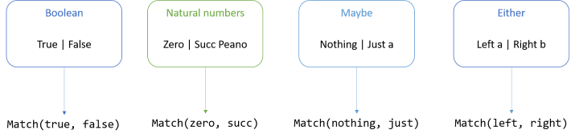

*A102 · 图 1 / Figure 1 · [图片来源 / Image source](https://blog.ploeh.dk/content/binary/binary-sum-types-and-matching-methods.png)*

[返回目录 / Back to catalogue](#catalogue)

---

<a id="a103"></a>

##### A103 · Church 编码的玫瑰树

*Church-encoded rose tree*

[原文 / Source](https://blog.ploeh.dk/2019/07/29/church-encoded-rose-tree/) · 发布日期 / Published: 2019/07/29

**中文导读**

此树允许任意多个子节点，并区分内部节点与叶子类型；函数式接口表达两类情况与递归子结构。阅读可结合后续树形归约，识别哪些数据与哪些行为在编码中对应。原文附诗是命名背景，本导读不收录诗文。

**English**

The encoded tree distinguishes leaves from internal nodes with arbitrary branching. Its interface exposes those alternatives and their recursive structure. Comparing it with later reductions clarifies how recursive data and consuming behavior correspond in this representation.

**思考 / Study question**

内部节点需要接收哪些子结构信息？ / What child-structure information does an internal-node handler need?

**原文配图 / Original illustrations**

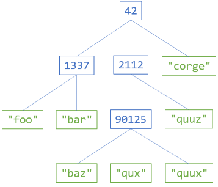

*A103 · 图 1 / Figure 1 · [图片来源 / Image source](https://blog.ploeh.dk/content/binary/rose-tree-example.png)*

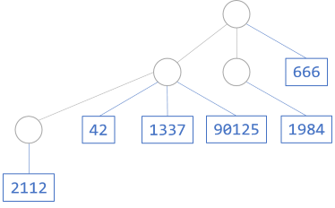

*A103 · 图 2 / Figure 2 · [图片来源 / Image source](https://blog.ploeh.dk/content/binary/meertens-tree-example.png)*

[返回目录 / Back to catalogue](#catalogue)

---

### 第五部分：结构归约 / Part V: Catamorphisms

<a id="a104"></a>

#### A104 · Catamorphism（结构归约）

*Catamorphisms*

[原文 / Source](https://blog.ploeh.dk/2019/04/29/catamorphisms/) · 发布日期 / Published: 2019/04/29

**中文导读**

Catamorphism 用一组与构造分支对应的处理方式，系统地消去一个数据结构。列表 fold 是熟悉特例，但布尔、自然数、Either、树都有各自形式。结果也可仍是结构，因此“归约”不必意味着压成一个数字。

**English**

A catamorphism consumes a datatype through handlers matching its constructors and recursive shape. List folding is a familiar case, not the entire concept. The result may itself be structured, so reduction is broader than computing a scalar total.

**思考 / Study question**

为什么树的归约不等于只遍历节点值？ / Why is tree reduction more than visiting node values?

**原文配图 / Original illustrations**

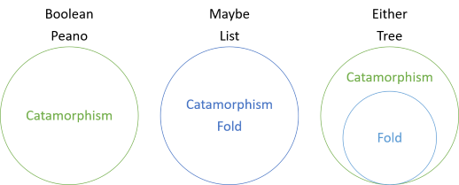

*A104 · 图 1 / Figure 1 · [图片来源 / Image source](https://blog.ploeh.dk/content/binary/catamorphism-and-fold-relations.png)*

[返回目录 / Back to catalogue](#catalogue)

---

<a id="a105"></a>

##### A105 · 布尔 Catamorphism

*Boolean catamorphism*

[原文 / Source](https://blog.ploeh.dk/2019/05/06/boolean-catamorphism/) · 发布日期 / Published: 2019/05/06

**中文导读**

布尔没有递归子结构，消去它只需给出真与假的结果，形状接近三元条件表达式。文章用 F-algebra 与 Fix 分析识别这个接口；这些包装主要服务理论推导，日常代码无需因此改写所有 if。

**English**

Boolean elimination selects a result for one of two nonrecursive cases. The familiar conditional expression provides the essential shape. The article's fixed-point and algebra machinery identifies that structure analytically, rather than proposing a more cumbersome everyday replacement for conditionals.

**思考 / Study question**

没有递归的数据也能有 Catamorphism 吗？ / Can nonrecursive data have a catamorphism?

[返回目录 / Back to catalogue](#catalogue)

---

<a id="a106"></a>

##### A106 · Peano Catamorphism

*Peano catamorphism*

[原文 / Source](https://blog.ploeh.dk/2019/05/13/peano-catamorphism/) · 发布日期 / Published: 2019/05/13

**中文导读**

自然数的构造是零与后继，因此归约需要零的结果和一个将前一结果推进一步的函数。连续应用该函数 n 次，就是消去数 n 的方式。它既不是普通泛型集合，也说明 Catamorphism 比列表 fold 更一般。

**English**

A zero result and a successor-step function consume a Peano number. Repeated steps reflect its recursive construction. This example helps separate structural elimination from the narrower intuition of folding elements inside a generic collection.

**思考 / Study question**

n 对结果函数意味着什么？ / What does n mean for the result-transforming function?

[返回目录 / Back to catalogue](#catalogue)

---

<a id="a107"></a>

##### A107 · Maybe Catamorphism

*Maybe catamorphism*

[原文 / Source](https://blog.ploeh.dk/2019/05/20/maybe-catamorphism/) · 发布日期 / Published: 2019/05/20

**中文导读**

Maybe 的归约需要一个缺失结果和一个有值处理函数，即常见的 Match 或 maybe 操作。它是总的消去接口，允许从两种情况得到统一结果。直接取值的部分函数会在缺失时失败，并非理解 Maybe 所必需。

**English**

Optional elimination handles both absence and presence to produce one result type. This total interface can express useful behavior without an unsafe value extractor. The example also shows a case where the ordinary fold and the catamorphism coincide.

**思考 / Study question**

怎样在不调用 Value/get 的情况下使用 Maybe？ / How can Maybe be used without an unsafe value extractor?

**原文配图 / Original illustrations**


*A107 · 图 1 / Figure 1 · [图片来源 / Image source](https://blog.ploeh.dk/content/binary/catamorphism-and-fold-relations.png)*

[返回目录 / Back to catalogue](#catalogue)

---

<a id="a108"></a>

##### A108 · 列表 Catamorphism

*List catamorphism*

[原文 / Source](https://blog.ploeh.dk/2019/05/27/list-catamorphism/) · 发布日期 / Published: 2019/05/27

**中文导读**

列表由空列表与“头元素加尾列表”构成，因此归约需要一个空结果和一个把头元素与尾部结果结合的函数。这对应结构上的右折叠。C# Aggregate 展示累积入口，但遇到非交换或非结合运算时，左右折叠方向必须明确。

**English**

List elimination replaces the empty case with a result and the cons case with a combining function over the head and reduced tail. This is the familiar structural fold. Implementation comparisons must retain direction, particularly for operations where grouping or order affects results.

**思考 / Study question**

左折叠与右折叠何时会不同？ / When do left and right folds differ?

[返回目录 / Back to catalogue](#catalogue)

---

<a id="a109"></a>

##### A109 · NonEmpty Catamorphism

*NonEmpty catamorphism*

[原文 / Source](https://blog.ploeh.dk/2023/08/07/nonempty-catamorphism/) · 发布日期 / Published: 2023/08/07

**中文导读**

非空集合的结构提供头元素与尾集合，不需要虚构空输入的默认值。文章以接受这两部分的消去函数呈现其通用 API，并可据此实现其他操作。要区分头尾分解的 Catamorphism 形状与具体半群归约算法。

**English**

A nonempty collection exposes a head and a tail for elimination. This structural guarantee removes the need for an empty-input seed. The resulting API can support other operations, while remaining distinct from a particular associative reduction over its values.

**思考 / Study question**

通用头尾消去与 reduce1 有何区别？ / How does general head-and-tail elimination differ from reduce1?

**原文配图 / Original illustrations**

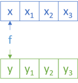

*A109 · 图 1 / Figure 1 · [图片来源 / Image source](https://blog.ploeh.dk/content/binary/non-empty-applicative-x-y.png)*

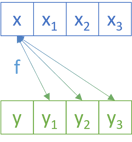

*A109 · 图 2 / Figure 2 · [图片来源 / Image source](https://blog.ploeh.dk/content/binary/non-empty-applicative-x-ys.png)*

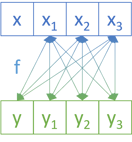

*A109 · 图 3 / Figure 3 · [图片来源 / Image source](https://blog.ploeh.dk/content/binary/non-empty-applicative-xs-ys.png)*

[返回目录 / Back to catalogue](#catalogue)

---

<a id="a110"></a>

##### A110 · Either Catamorphism

*Either catamorphism*

[原文 / Source](https://blog.ploeh.dk/2019/06/03/either-catamorphism/) · 发布日期 / Published: 2019/06/03

**中文导读**

Either 的 Catamorphism 接受两个分支函数，分别处理 Left 和 Right，并产出同一类型。只把右侧看作集合的普通 fold 无法充分利用左侧内容，因此能力更弱；bifold 则能对应处理两个维度。

**English**

Either elimination handles both alternatives explicitly. A conventional one-sided fold cannot exploit the inactive-as-elements side in the same way. Comparing fold, bifold, and the catamorphism makes their differing treatment of the two parameters visible.

**思考 / Study question**

为什么只折叠 Right 会忽略错误信息？ / Why does folding only Right overlook error information?

**原文配图 / Original illustrations**


*A110 · 图 1 / Figure 1 · [图片来源 / Image source](https://blog.ploeh.dk/content/binary/catamorphism-and-fold-relations.png)*

[返回目录 / Back to catalogue](#catalogue)

---

<a id="a111"></a>

##### A111 · 树 Catamorphism

*Tree catamorphism*

[原文 / Source](https://blog.ploeh.dk/2019/06/10/tree-catamorphism/) · 发布日期 / Published: 2019/06/10

**中文导读**

先递归归约各子树，再把当前节点值与子树结果集合交给处理函数。保留这种结构信息，可计算叶子数、重建树或做其他变换；若只按节点值平铺，某些拓扑信息已经丢失，便无法表达相同运算。

**English**

Tree elimination combines each node value with results already obtained from its children. It retains enough structural information for topology-sensitive operations. Flattening node values first can discard precisely the information required for computations such as counting leaves.

**思考 / Study question**

为什么平铺节点后可能无法数叶子？ / Why might flattened node values be insufficient to count leaves?

**原文配图 / Original illustrations**


*A111 · 图 1 / Figure 1 · [图片来源 / Image source](https://blog.ploeh.dk/content/binary/tree-example.png)*


*A111 · 图 2 / Figure 2 · [图片来源 / Image source](https://blog.ploeh.dk/content/binary/catamorphism-and-fold-relations.png)*

[返回目录 / Back to catalogue](#catalogue)

---

<a id="a112"></a>

##### A112 · 玫瑰树 Catamorphism

*Rose tree catamorphism*

[原文 / Source](https://blog.ploeh.dk/2019/08/05/rose-tree-catamorphism/) · 发布日期 / Published: 2019/08/05

**中文导读**

不同类型的叶子与内部节点，需要两种处理函数。叶子函数直接生成结果；节点函数取得节点标签和已归约的子节点结果。这样能保留双参数树的结构差异，比把所有数据先统一成一个扁平列表更丰富。

**English**

Distinct leaf and internal-node representations lead to two elimination handlers. Leaves produce results directly, while internal nodes combine their labels with reduced children. This exposes both the tree topology and the differing roles of the stored data.

**思考 / Study question**

节点函数为何接收子树结果而非原始子树？ / Why does the node handler receive reduced children?

**原文配图 / Original illustrations**


*A112 · 图 1 / Figure 1 · [图片来源 / Image source](https://blog.ploeh.dk/content/binary/rose-tree-example.png)*

[返回目录 / Back to catalogue](#catalogue)

---

<a id="a113"></a>

##### A113 · 满二叉树 Catamorphism

*Full binary tree catamorphism*

[原文 / Source](https://blog.ploeh.dk/2019/06/24/full-binary-tree-catamorphism/) · 发布日期 / Published: 2019/06/24

**中文导读**

这里的满二叉树中，每个内部节点恰有两个子节点；叶子单独成案。对应归约需要叶子处理与内部节点处理，后者接收两个子结果。Visitor 的 Accept 也可体现这种消去方式，但可折叠并不自动意味着是 Monad。

**English**

A full binary tree has a leaf case and a branch case with exactly two children. Its elimination mirrors that structure through two handlers. The example connects Visitor consumption to catamorphisms and separates the ability to fold from the ability to form a monad.

**思考 / Study question**

有 fold 的类型为什么未必有 Bind？ / Why does having a fold not imply having Bind?

**原文配图 / Original illustrations**


*A113 · 图 1 / Figure 1 · [图片来源 / Image source](https://blog.ploeh.dk/content/binary/full-binary-tree-example.png)*

[返回目录 / Back to catalogue](#catalogue)

---

<a id="a114"></a>

##### A114 · 支付类型 Catamorphism

*Payment types catamorphism*

[原文 / Source](https://blog.ploeh.dk/2019/07/08/payment-types-catamorphism/) · 发布日期 / Published: 2019/07/08

**中文导读**

三种支付情况对应三个消去分支，统一到同一结果类型。文章用领域专用类型说明，Catamorphism 并不只适用于标准库列表或树。实际语言已有模式匹配时，可用更直接的写法，无需为了推导包装全部类型。

**English**

A custom payment alternative is eliminated through three corresponding handlers. The example extends structural reduction beyond standard computer-science datatypes. Existing pattern matching may be the practical API, while the catamorphism supplies an account of why that consumption shape is complete.

**思考 / Study question**

自定义和类型的消去接口怎样确定？ / How is an eliminator determined for a custom sum type?

[返回目录 / Back to catalogue](#catalogue)

---

### 第六部分：设计模式与通用抽象 / Part VI: Patterns and universal abstractions

<a id="a115"></a>

#### A115 · 把部分设计模式视作通用抽象

*Some design patterns as universal abstractions*

[原文 / Source](https://blog.ploeh.dk/2018/03/05/some-design-patterns-as-universal-abstractions/) · 发布日期 / Published: 2018/03/05

**中文导读**

作者把可组合软件的希望放在较小、受法则约束的构件上，再挑选若干模式分析其数学形状。这个目录不是全部 GoF 模式的分类证明，Null Object 也不是 GoF 原书条目。具体对应需要逐篇观察接口及组合语义。

**English**

Small lawful structures motivate the selected pattern comparisons. The catalogue is exploratory rather than a classification of every classic pattern, and includes Null Object from outside the original GoF list. Each proposed relationship must be read with its interface and behavior assumptions.

**思考 / Study question**

为什么“部分模式”是重要范围限定？ / Why does the restriction to selected patterns matter?

**原文配图 / Original illustrations**


*A115 · 图 1 / Figure 1 · [图片来源 / Image source](https://blog.ploeh.dk/content/binary/lego-bricks-as-connections.png)*

[返回目录 / Back to catalogue](#catalogue)

---

<a id="a116"></a>

##### A116 · Composite 的幺半群视角

*Composite as a monoid*

[原文 / Source](https://blog.ploeh.dk/2018/03/12/composite-as-a-monoid/) · 发布日期 / Published: 2018/03/12

**中文导读**

当各方法结果能以幺半群规则合并时，多个对象可逐方法聚合成 Composite，空 Composite 返回单位结果。要指定合并运算及观察语义，不能从返回类型单独推出结论。作者也讨论半群及更弱结构下的限制。

**English**

Monoidal method results provide a systematic Composite recipe: combine corresponding results, with identities for an empty collection. The operation and observable behavior must be explicit. The article also considers weaker structures, showing why a compilable composition is not automatically an intuitive one.

**思考 / Study question**

空 Composite 的每个方法应返回什么？ / What should each method of an empty Composite return?

**原文配图 / Original illustrations**


*A116 · 图 1 / Figure 1 · [图片来源 / Image source](https://blog.ploeh.dk/content/binary/composite-as-subset-of-monoid.png)*

[返回目录 / Back to catalogue](#catalogue)

---

<a id="a117"></a>

###### A117 · 合并回退型 Composite

*Coalescing Composite as a monoid*

[原文 / Source](https://blog.ploeh.dk/2018/04/09/coalescing-composite-as-a-monoid/) · 发布日期 / Published: 2018/04/09

**中文导读**

多个 Repository 依次尝试，返回第一个非空结果，看似不支持“把两个值加起来”，但其实采用了 Maybe 的 First 幺半群。它把回退选择解释为一种合并规则。实际查询要考虑惰性，否则无用的后续 I/O 仍可能发生。

**English**

A fallback composite selects the earliest present repository result. Optional First supplies the algebraic rule even when returned entities have no natural addition. Execution must also respect the intended fallback behavior, avoiding unnecessary later I/O through an appropriate lazy strategy.

**思考 / Study question**

找到结果后是否还会查询下一项？ / Will later repositories still be queried after a result is found?

[返回目录 / Back to catalogue](#catalogue)

---

<a id="a118"></a>

###### A118 · 自同态型 Composite

*Endomorphic Composite as a monoid*

[原文 / Source](https://blog.ploeh.dk/2018/04/16/endomorphic-composite-as-a-monoid/) · 发布日期 / Published: 2018/04/16

**中文导读**

若方法形状是 T→T，可让前一个对象的输出成为后一个的输入。此时无需给 T 定义加法；可合并的是转换函数本身，其结构是自同态幺半群。它解释了流水线式 Composite 与逐点聚合结果式 Composite 的不同机制。

**English**

A same-type transformation can feed its output into the next transformation. The underlying values need no monoidal addition because function composition supplies the monoid. This distinguishes pipeline-style composites from those that independently evaluate components and merge their returned values.

**思考 / Study question**

可组合的究竟是值还是转换函数？ / Are values or transformation functions being combined?

[返回目录 / Back to catalogue](#catalogue)

---

<a id="a119"></a>

##### A119 · Null Object 作为单位元

*Null Object as identity*

[原文 / Source](https://blog.ploeh.dk/2018/04/23/null-object-as-identity/) · 发布日期 / Published: 2018/04/23

**中文导读**

对已有组合规则，Null Object 的含义是加入它后不改变观察结果，而非随意返回某个默认值。它可视为零成员 Composite 的行为。只有在运算与领域语义下确实中立时，空字符串、零值或空列表才是恰当返回。

**English**

A natural Null Object behaves neutrally under a specified composition operation. It corresponds to an empty composite's behavior, rather than an arbitrary default. Candidate return values must therefore be evaluated against both the combining rule and the domain's observable expectations.

**思考 / Study question**

默认值为什么不一定是单位元？ / Why might a default value fail to be an identity?

**原文配图 / Original illustrations**


*A119 · 图 1 / Figure 1 · [图片来源 / Image source](https://blog.ploeh.dk/content/binary/null-object-identity-set-diagram.png)*

[返回目录 / Back to catalogue](#catalogue)

---

<a id="a120"></a>

##### A120 · Builder 的幺半群视角

*Builder as a monoid*

[原文 / Source](https://blog.ploeh.dk/2020/02/17/builder-as-a-monoid/) · 发布日期 / Published: 2020/02/17

**中文导读**

把每次 Builder 修改看成构建状态 T→T，就可复合这些修改，空修改为恒等。文章以 HTTP 请求及测试数据说明“合理默认值加可组合定制”的适用点。顺序可能影响覆盖结果，因此并不要求各修改可交换。

**English**

Builder modifiers can be represented as endomorphisms over construction state. Composition assembles customizations, and doing nothing supplies the identity. Defaults plus selective overrides provide a useful application, while the order of modifiers may still determine the final configuration.

**思考 / Study question**

两个覆盖同一字段的修改能交换吗？ / Can two modifiers overriding the same field be swapped?

**原文配图 / Original illustrations**


*A120 · 图 1 / Figure 1 · [图片来源 / Image source](https://blog.ploeh.dk/content/binary/single-step-endomorphism.png)*


*A120 · 图 2 / Figure 2 · [图片来源 / Image source](https://blog.ploeh.dk/content/binary/single-object-depicted-as-a-circle.png)*


*A120 · 图 3 / Figure 3 · [图片来源 / Image source](https://blog.ploeh.dk/content/binary/double-step-endomorphism.png)*

[返回目录 / Back to catalogue](#catalogue)

---

<a id="a121"></a>

##### A121 · Visitor 作为和类型

*Visitor as a sum type*

[原文 / Source](https://blog.ploeh.dk/2018/06/25/visitor-as-a-sum-type/) · 发布日期 / Published: 2018/06/25

**中文导读**

把 Church 编码的多个分支函数收进参数对象，再提取接口并重命名，可得到 Visitor 形式。它表示固定的互斥情况，而非任意开放继承体系。两种表示可有同等表达能力，但代码量、穷尽检查与维护体验差异明显。

**English**

Refactoring case handlers into an interface connects Church-encoded alternatives with Visitor. The comparison concerns a fixed collection of mutually exclusive cases. Equivalent expressiveness does not remove differences in verbosity, exhaustiveness support, or how comfortably each representation fits its language.

**思考 / Study question**

固定分支与开放子类集合有何区别？ / How do fixed alternatives differ from an open subclass hierarchy?

[返回目录 / Back to catalogue](#catalogue)

---

<a id="a122"></a>

##### A122 · 责任链作为 Catamorphism 组合

*Chain of Responsibility as catamorphisms*

[原文 / Source](https://blog.ploeh.dk/2019/07/22/chain-of-responsibility-as-catamorphisms/) · 发布日期 / Published: 2019/07/22

**中文导读**

把候选处理器放入有序列表，每个返回 Maybe；用 First 合并得到首个结果，再消去 Maybe 取得结果或默认值。文章的头像读取例子保留处理器分工及顺序可配置性。为保留短路行为，真实 I/O 需延迟执行。

**English**

An ordered collection of optional-result handlers can be reduced with First, then eliminated through Maybe handling. This reproduces fallback-chain behavior while keeping components separate. Laziness matters when handlers perform I/O, because algebraic result selection alone does not prevent eager execution.

**思考 / Study question**

结果相同是否足以保证责任链等价？ / Is equal output enough to establish equivalent chain behavior?

**原文配图 / Original illustrations**


*A122 · 图 1 / Figure 1 · [图片来源 / Image source](https://blog.ploeh.dk/content/binary/chain-of-responsibility-diagram.png)*


*A122 · 图 2 / Figure 2 · [图片来源 / Image source](https://blog.ploeh.dk/content/binary/default-user-icon.png)*


*A122 · 图 3 / Figure 3 · [图片来源 / Image source](https://blog.ploeh.dk/content/binary/chain-of-responsibility-as-a-linked-list.png)*


*A122 · 图 4 / Figure 4 · [图片来源 / Image source](https://blog.ploeh.dk/content/binary/chain-of-responsibility-as-a-linked-list-single-fold.png)*


*A122 · 图 5 / Figure 5 · [图片来源 / Image source](https://blog.ploeh.dk/content/binary/chain-of-responsibility-as-a-linked-list-double-fold.png)*

[返回目录 / Back to catalogue](#catalogue)

---

<a id="a123"></a>

##### A123 · State 模式与 State Monad

*The State pattern and the State monad*

[原文 / Source](https://blog.ploeh.dk/2022/09/05/the-state-pattern-and-the-state-monad/) · 发布日期 / Published: 2022/09/05

**中文导读**

State 模式结合多态状态对象与可变 Context；重构时把“更新状态”改为返回状态，并连同原结果返回。State Monad 提供状态串联，多态则另行保留。因此关系不是两个名字的直接同义，而是多态加状态计算结构的对应。

**English**

Refactoring mutation into explicit state returns connects the pattern with State computations. Polymorphism remains an additional ingredient. The comparison therefore relates a combination of mechanisms, rather than treating the State pattern and State monad as interchangeable names for one thing.

**思考 / Study question**

去掉 Context 后，多态还在哪里？ / Where does polymorphism remain after removing Context?

**原文配图 / Original illustrations**


*A123 · 图 1 / Figure 1 · [图片来源 / Image source](https://blog.ploeh.dk/content/binary/state-pattern-venn.png)*


*A123 · 图 2 / Figure 2 · [图片来源 / Image source](https://blog.ploeh.dk/content/binary/state-monad-venn.png)*

[返回目录 / Back to catalogue](#catalogue)

---

<a id="a124"></a>

###### A124 · 把 TCP State 示例重构成纯函数

*Refactoring the TCP State pattern example to pure functions*

[原文 / Source](https://blog.ploeh.dk/2022/09/26/refactoring-the-tcp-state-pattern-example-to-pure-functions/) · 发布日期 / Published: 2022/09/26

**中文导读**

GoF 的 TCP 示例多数方法没有有意义的返回值，副作用细节也未完整展开。重构后只需返回新连接状态即可，实际退化为自同态，未必需要完整 State Monad。它是重要反例：不是每个状态机都值得引入同样的抽象。

**English**

The TCP example is structurally degenerate because useful outputs and effect details are absent. Returning the updated connection can suffice, leaving endomorphisms rather than requiring the full State machinery. The example clarifies when a smaller abstraction already expresses the necessary behavior.

**思考 / Study question**

什么新增需求会使完整 State 结构必要？ / What additional requirement would justify the full State structure?

[返回目录 / Back to catalogue](#catalogue)

---

<a id="a125"></a>

###### A125 · 把 Saga 从 State 模式重构到 State Monad

*Refactoring a saga from the State pattern to the State monad*

[原文 / Source](https://blog.ploeh.dk/2022/10/10/refactoring-a-saga-from-the-state-pattern-to-the-state-monad/) · 发布日期 / Published: 2022/10/10

**中文导读**

订单与付款通知可能乱序到达；都收到后才产生发货命令。文章先加特征测试，再把命令移为返回数据、显式返回状态，最后由解释器执行。作者明确偏好生产中较简单的布尔实现，本次复杂重构用于展示表达能力。

**English**

The shipping workflow waits for two messages that may arrive in either order. Refactoring returns commands and state explicitly, with an interpreter handling effects. The author favors the simpler original implementation for production; the richer versions are demonstrations, not mandatory upgrades.

**思考 / Study question**

业务决策与发消息如何分离？ / How are business decisions separated from sending messages?

**原文配图 / Original illustrations**


*A125 · 图 1 / Figure 1 · [图片来源 / Image source](https://blog.ploeh.dk/content/binary/shipping-policy-state-diagram.png)*

[返回目录 / Back to catalogue](#catalogue)

---

<a id="a126"></a>

##### A126 · Postel 法则的 Profunctor 视角

*Postel's law as a profunctor*

[原文 / Source](https://blog.ploeh.dk/2021/11/29/postels-law-as-a-profunctor/) · 发布日期 / Published: 2021/11/29

**中文导读**

文章把输入输出看成可接受值的集合，用管道图说明输入放宽、输出收紧的方向。这与函数输入逆变、输出协变的形状相关。它是边界分析视角，不应仅从图像相似就推断完整协议鲁棒性或所有实现都满足函子法则。

**English**

A pipe metaphor relates broader accepted inputs and more constrained outputs to function variance. The profunctor perspective clarifies adaptation direction. It remains a structural reading of the principle, rather than a complete guarantee about protocol robustness or every concrete implementation.

**思考 / Study question**

输入变宽与输出变宽的影响为何不同？ / Why do wider inputs and wider outputs affect clients differently?

**原文配图 / Original illustrations**


*A126 · 图 1 / Figure 1 · [图片来源 / Image source](https://blog.ploeh.dk/content/binary/horizontal-pipe.png)*


*A126 · 图 2 / Figure 2 · [图片来源 / Image source](https://blog.ploeh.dk/content/binary/two-composed-horizontal-pipes.png)*


*A126 · 图 3 / Figure 3 · [图片来源 / Image source](https://blog.ploeh.dk/content/binary/partial-decrement-set-diagram.png)*


*A126 · 图 4 / Figure 4 · [图片来源 / Image source](https://blog.ploeh.dk/content/binary/total-decrement-set-diagram.png)*


*A126 · 图 5 / Figure 5 · [图片来源 / Image source](https://blog.ploeh.dk/content/binary/encode-even-set-diagram.png)*


*A126 · 图 6 / Figure 6 · [图片来源 / Image source](https://blog.ploeh.dk/content/binary/misaligned-pipes.png)*


*A126 · 图 7 / Figure 7 · [图片来源 / Image source](https://blog.ploeh.dk/content/binary/misaligned-drain-pipes.jpg)*


*A126 · 图 8 / Figure 8 · [图片来源 / Image source](https://blog.ploeh.dk/content/binary/flanged-pipe.png)*


*A126 · 图 9 / Figure 9 · [图片来源 / Image source](https://blog.ploeh.dk/content/binary/transparent-flange.png)*


*A126 · 图 10 / Figure 10 · [图片来源 / Image source](https://blog.ploeh.dk/content/binary/flange-composition.png)*

[返回目录 / Back to catalogue](#catalogue)

---

<a id="a127"></a>

##### A127 · 里氏替换原则的 Profunctor 视角

*The Liskov Substitution Principle as a profunctor*

[原文 / Source](https://blog.ploeh.dk/2021/12/06/the-liskov-substitution-principle-as-a-profunctor/) · 发布日期 / Published: 2021/12/06

**中文导读**

子类型可放宽前置条件、加强后置条件，反向改变可能破坏调用者。文章以预订查询与 SQL 实现说明这类替换方向，并将其联系到 Profunctor。完整 LSP 还涉及其他行为约束，不能把一个类型转换图当成全部证明。

**English**

The reservation example connects weakened preconditions and strengthened postconditions with input and output variance. This provides a profunctor reading of a familiar substitution rule. Concrete substitutability still requires the relevant behavioral guarantees, beyond a compatible-looking type signature.

**思考 / Study question**

为何子类型不能要求调用者做更多？ / Why must a subtype not demand more from callers?

**原文配图 / Original illustrations**


*A127 · 图 1 / Figure 1 · [图片来源 / Image source](https://blog.ploeh.dk/content/binary/lsp-pipes.png)*

[返回目录 / Back to catalogue](#catalogue)

---

<a id="a128"></a>

##### A128 · 向后兼容的 Profunctor 视角

*Backwards compatibility as a profunctor*

[原文 / Source](https://blog.ploeh.dk/2021/12/13/backwards-compatibility-as-a-profunctor/) · 发布日期 / Published: 2021/12/13

**中文导读**

将替换方向从类型层次转到版本演进：新版本至少支持旧输入，并保持旧输出保证，可进一步接受更多输入或加强保证。文中也用追加测试用例与断言解释契约演进。这里的保证不仅是返回类型，还包括调用者可观察行为。

**English**

Version evolution can be analyzed through the same contract direction as substitution. Existing supported inputs and output guarantees must remain valid, while acceptance or guarantees may be extended. The testing discussion illustrates this contract perspective without reducing compatibility to type signatures alone.

**思考 / Study question**

新增版本如何保住旧调用者的假设？ / How can a new version preserve old clients' assumptions?

**原文配图 / Original illustrations**


*A128 · 图 1 / Figure 1 · [图片来源 / Image source](https://blog.ploeh.dk/content/binary/type-hierarchy-and-time.png)*


*A128 · 图 2 / Figure 2 · [图片来源 / Image source](https://blog.ploeh.dk/content/binary/function-pipes-on-timeline.png)*


*A128 · 图 3 / Figure 3 · [图片来源 / Image source](https://blog.ploeh.dk/content/binary/function-pipes-and-clients-on-timeline.png)*


*A128 · 图 4 / Figure 4 · [图片来源 / Image source](https://blog.ploeh.dk/content/binary/function-pipe-flanged-pipe-and-clients-on-timeline.png)*

[返回目录 / Back to catalogue](#catalogue)

---


---

<a id="examples"></a>

## 补充练习：把概念落到代码 / Supplemental exercises

本节代码为整理者新写的短示例，不是博客代码摘录。假定使用支持 record 与 LINQ 的现代 C#。其用途是供阅读后自己推演，不构成完整项目；数值示例忽略极端溢出，并用纯、有限计算讨论法则。

These short examples are newly written exercises, not copied source listings. They assume modern C# with records and LINQ, and use finite pure computations. Numeric edge cases such as overflow lie outside their illustrative model.

### 练习 1：可以分组，不能换序 / Regrouping is not reordering

```csharp
using System;

Func<int, int> plusThree = x => x + 3;
Func<int, int> timesTwo = x => x * 2;
Func<int, int> identity = x => x;

// Compose(first, second)(x) runs first, then second.
static Func<int, int> Compose(Func<int, int> first, Func<int, int> second)
    => x => second(first(x));

Console.WriteLine(Compose(plusThree, timesTwo)(4)); // 14
Console.WriteLine(Compose(timesTwo, plusThree)(4)); // 11
Console.WriteLine(Compose(identity, plusThree)(4)); // 7
```

请自己加入第三个纯转换，比较两种括号分组，再比较换序。将这个例子连接到 A009、A118 和 A120。

Add a third pure transformation and compare regrouping against reordering. Relate the results to A009, A118, and A120.

### 练习 2：同一个列表，三种组合 / Three combinations over lists

```csharp
using System;
using System.Linq;

int[] xs = { 2, 5 };
int[] ys = { 10, 20, 30 };

var mapped = xs.Select(x => x + 1);               // 3, 6
var independent = xs.SelectMany(
    x => ys, (x, y) => x + y);                    // 12,22,32,15,25,35
var dependent = xs.SelectMany(
    x => Enumerable.Range(0, x));                // 0,1,0,1,2,3,4
```

第二行组合中的 `ys` 不依赖 `x`，其问题结构可用列表 Applicative 描述；第三个生成的列表长度由 `x` 决定，是依赖组合。C# 可以都用 SelectMany 写出，但相同语法不代表问题需要相同强度的抽象。参见 A038、A040、A068。

The independent combination could be described applicatively, while the last range depends on its preceding value. C# can express both through SelectMany. Shared syntax does not determine the weakest abstraction needed for the problem.

### 练习 3：返回新状态 / Returning new state

```csharp
using System;

// Requires balance >= amount >= 0; overflow ignored for this exercise.
static (string Value, int State) Spend(int balance, int amount)
    => ($"Spent {amount}", balance - amount);

var first = Spend(100, 12);
var second = Spend(first.State, 8);
Console.WriteLine(second.State); // 80
```

把状态改为不可变领域对象，再为“不足余额”设计显式错误结果。随后问：失败时应保留什么状态？这会把练习从 A032、A074 引向 A085 的层次选择，而不是只有一个必然答案。

Replace the integer state with an immutable domain value and add an explicit insufficient-funds result. Decide which state a failure should retain. This leads from state sequencing to the interaction of state and failure layers.

<a id="questions"></a>

## 阅读后的提问模板 / Follow-up question templates

每篇末尾已有一个具体思考问题。还可用以下模板向我提问；指定编号和你的代码上下文会更容易获得针对性解释。

Each entry has a study question. These additional templates help focus a follow-up on an article and a concrete programming context.

- “请用 C# 逐步解释 A009 的自同态幺半群，并说明恒等函数为何是单位元。” / “Explain A009 step by step in C#, including its identity.”
- “A042 的累积验证为何不能直接沿用 A070 的短路 Bind？” / “Why does accumulating validation differ from short-circuiting bind?”
- “我有这个接口，请判断是否适合 A116 的 Composite，并检查相等、单位与副作用。” / “Assess my interface against the Composite construction.”
- “请沿 A121 的重构过程说明 Visitor 怎样表示和类型。” / “Walk through the Visitor-to-sum-type relationship.”
- “请把我的可变状态方法按 A125 拆成决策函数与解释器。” / “Separate my stateful method into a decision function and an interpreter.”
- “A036 的补记改变了什么？哪些数学集合映射仍合法？” / “What does the Set article's postscript change?”

### 自检清单 / Reading self-check

- [ ] 能写出封闭、结合、单位的区别。 / I can distinguish closure, associativity, and identity.
- [ ] 知道幺半群可以不交换。 / I know that a monoid need not be commutative.
- [ ] 能区分 map、独立组合与依赖 Bind。 / I can distinguish mapping, independent combination, and dependent bind.
- [ ] 能说明语义相等及纯函数假设。 / I can state the relevant equality and purity assumptions.
- [ ] 能区分自然变换与同构。 / I can distinguish a natural transformation from an isomorphism.
- [ ] 知道树的 Catamorphism 可保留结构信息。 / I understand how a tree catamorphism retains structural information.
- [ ] 不会从模式名称或方法名称直接推导法则。 / I do not infer laws from names alone.
- [ ] 知道教学上可行的重构未必是生产中的最佳选择。 / I distinguish educational expressiveness from production design choices.

---

## 文件与来源说明 / Files and provenance

- 本文 / Main document：`范畴论下的设计模式-中英双语阅读指南.md`。
- 正文配图 / Local figures：`img/`，83 个独立原始文件，正文引用 90 次；相同来源图片复用本地文件。
- 文章来源索引 / Source index：`文章索引.tsv`，含文章编号、主题层级、原始英文标题和来源 URL。
- 图片来源索引 / Image provenance：`图片索引.tsv`，含文章编号、图号、本地文件及原始 URL。

范围以读取当天入口页中的系列目录为准，没有递归把每篇正文链接到的外部材料、评论或其他系列纳入。配图仅保存各文章正文中的图片，未保存作者头像、站点图标与装饰元素。按页来源链接可核查摘要及图像上下文。

Scope follows the series catalogue in the entry page as retrieved on the compilation date. Outbound references, comments, and unrelated series are excluded. Only body images are included, excluding portraits and site decoration. Source links support checking both the summaries and image context.
